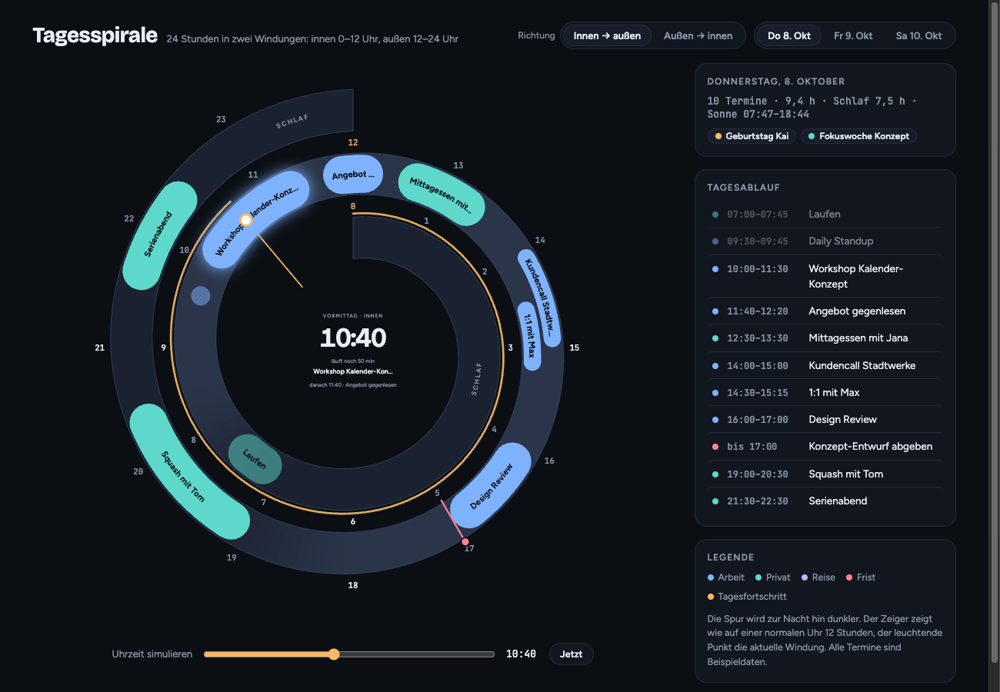
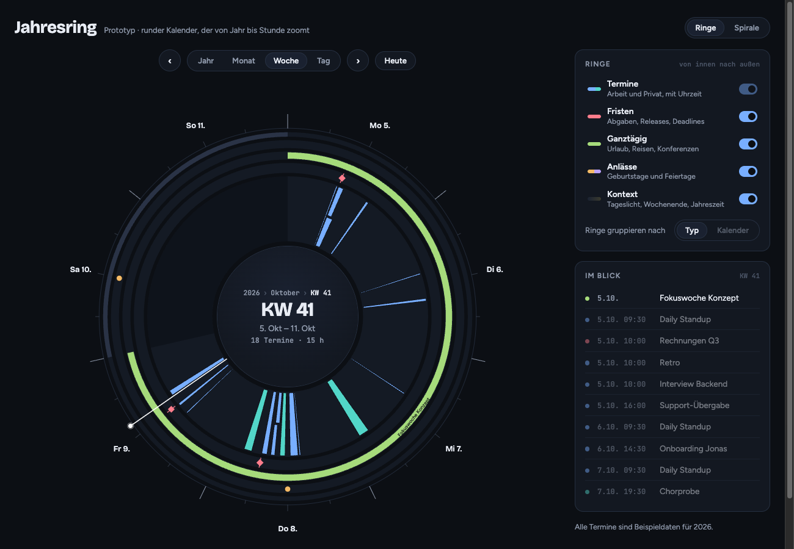
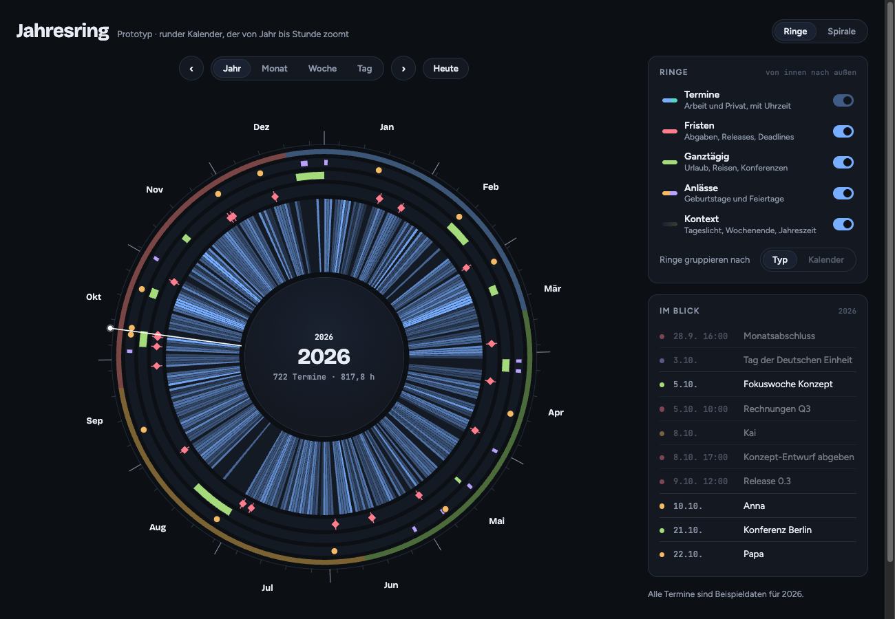
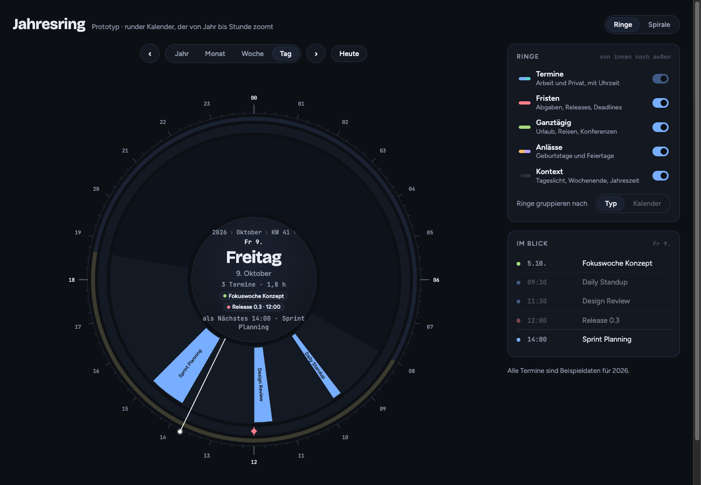
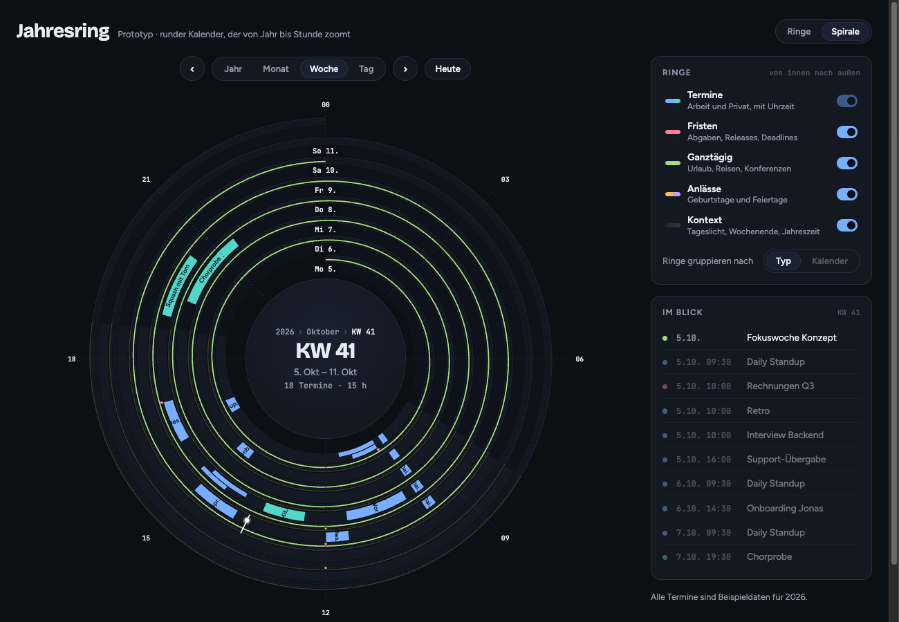

# Kalender: alternative Darstellungen

Stand: 2026-10-09. Ideensammlung für `torrocalendar` (TUI) und die spätere Kalender-GUI (Phase 3, Technik noch offen).
Noch nichts davon ist entschieden. Die Prototypen sind klickbare HTML-Seiten mit Beispieldaten
und dienen nur dazu, das Gefühl der Darstellung zu prüfen.

## Ausgangslage

Die üblichen Ansichten (Monatsraster, Wochenraster, Stundenliste) wirken überholt. Gesucht ist
eine Darstellung, die eher dem entspricht, wie man einen Tag oder ein Jahr im Kopf hat.

## Prototypen

| Prototyp | Datei | Status |
|---|---|---|
| Tagesspirale | [prototypes/calendar/tagesspirale.html](prototypes/calendar/tagesspirale.html) | **Favorit** für die Tagesansicht |
| Jahresring | [prototypes/calendar/jahresring.html](prototypes/calendar/jahresring.html) | Konzept für Zoom von Jahr bis Tag |

Lokal ansehen: Datei im Browser öffnen, sie braucht keinen Server.

### Tagesspirale (Favorit)

Ein normales 12-Stunden-Zifferblatt, auf dem die 24 Stunden als Spirale mit zwei Windungen
liegen. Die Spirale beginnt um 0 Uhr oben **innen**, läuft einmal herum und wechselt um 12 Uhr
auf die **äußere** Windung für Nachmittag und Abend.

Warum sie überzeugt:

- Sie entspricht dem Bild, das man im Kopf hat, wenn man durch den Tag geht: eine Uhr,
  aber ohne die Mehrdeutigkeit von Vormittag und Nachmittag.
- Innen nach außen: Die Nacht liegt auf der kürzesten Windung und nimmt wenig Fläche ein.
  Nachmittag und Abend, wo meist die meisten Termine liegen, haben die längste Windung.
- Der Stundenzeiger zeigt wie auf einer echten Uhr, ein leuchtender Punkt markiert die
  aktuelle Windung.

Gestaltungsregeln, die sich beim Ausprobieren ergeben haben:

- **Gleichmäßigkeit ist Pflicht.** Die Spur hat überall dieselbe Breite, und die Spiralform
  muss durchgehend sichtbar sein: feine Kante innen und außen, Nachtfarbe klar vom Hintergrund
  abgesetzt. Sonst entstehen optische Knicke.
- **Keine Kreisform gegen die Spirale stellen.** Ein umrandeter Mittelkreis lässt die
  Abstände ungleich wirken. Die Mitte bleibt deshalb ohne Rahmen.
- **Zeit nicht verzerren.** Jede Stunde bekommt denselben Winkel, sonst passt es nicht mehr zur Uhr.
- Termine als abgerundete Bögen, Beschriftung entlang des Bogens und immer aufrecht lesbar.
  Sehr kurze Termine werden zu Punkten.
- Überlappende Termine teilen sich die Spur in parallele Bahnen.
- Fristen als Markierung quer zur Spur.
- Tageslicht als weicher Farbverlauf der Spur, Tagesfortschritt als dünne Linie am Rand.
- In der Mitte: Uhrzeit, „läuft noch 19 min“ bzw. „frei für 1 h 20 min“ und der nächste Termin.

Ausprobiert und verworfen:

| Variante | Warum verworfen |
|---|---|
| Spirale von außen nach innen | Die innere Windung wird zur Mitternacht hin eng; die Abendtermine haben wenig Platz. Bleibt im Prototyp als Umschalter zum Vergleich. |
| Zwei konzentrische Ringe (0–12 außen, 12–24 innen) mit Übergang bei 12 Uhr | Wirkt geordnet, aber der harte Sprung an der Naht und das Teilen von Terminen über 12 Uhr überzeugen nicht. |
| Nacht schmal darstellen (Spur im Schlaf dünner) | Sieht unförmig aus. |
| Nacht zeitlich stauchen (Schlaf bekommt weniger Winkel) | Passt nicht mehr zu den Uhrzeiten und zum Gefühl für den Tag. Kommt nicht in Frage. |

### Jahresring

Ein runder Kalender, der wie eine Karte von **Jahr → Monat → Woche → Tag** zoomt. Ein Klick auf
ein Segment klappt es zum vollen Kreis auf. Scrollen zoomt, Ziehen dreht durch die Zeit.

Die Ringe sind wie Jahresringe eines Baums nach Typ getrennt, von innen nach außen:

1. **Termine** mit Uhrzeit, breitester Ring
2. **Fristen**
3. **Ganztägig** (Urlaub, Reisen, Konferenzen)
4. **Anlässe** (Geburtstage, Feiertage)
5. **Kontext** (Tageslicht, Wochenenden, Jahreszeiten), sehr dünn

Termine liegen innen, alles, was keine direkten Termine sind, außen und dünner.
Ganztägiges und Geburtstage überlagern keine Termine, weil sie eigene Ringe haben.

**Semantic Zoom:** Die Ringe ändern ihre Darstellung je Zoomstufe.

- Termine: im Tag und in der Woche als Bögen mit Titel, ab dem Monat als Heatmap der Auslastung
- Ganztägig und Anlässe: im Tag eingeklappt; was ansteht, erscheint in der Mitte als Chip
- Kontext: Tag/Nacht im Tag, Wochenenden in Woche und Monat, Jahreszeiten im Jahr

| Jahr | Tag | Spirale (Woche) |
|---|---|---|
|  |  |  |

Offen:

- Gruppierung der Ringe **nach Kalender** statt nach Typ, sobald mehrere Kalender verbunden sind
  (im Prototyp als deaktivierte Option angelegt). Die meisten Nutzer haben nur einen Kalender,
  deshalb ist „nach Typ“ der Standard.
- Die Spiralvariante des Jahresrings (eine Windung = eine Einheit) wirkt im Jahr zu dünn.
- Die Tagesansicht des Jahresrings könnte durch die Tagesspirale ersetzt werden.

## Weitere Ideen aus der Recherche

Noch nicht prototypisch umgesetzt, aber als Anregung festgehalten:

| Ansatz | Beispiele |
|---|---|
| Durchgehender Zeitstrom statt getrennter Ansichten | [HEY Calendar](https://hey.com/calendar), [Studie Hund et al. (UCL)](https://discovery.ucl.ac.uk/id/eprint/1408077/) |
| Zoombare Zeitachse ohne Tag/Woche/Monat | [Fluxcal](https://www.whub.io/startups/fluxcal), [Calizo](https://calizo.sourceforge.net/about.shtml) |
| 24-Stunden-Ring | [Sectograph](https://apps.apple.com/app/id1528168188), [DayZen](https://alternativeto.net/software/dayzen/about), [Radial Week View](https://21st.dev/@ruixen.ui/components/radial-week-view.md) |
| Timeline mit sichtbaren Lücken | [Structured](https://daveswift.com/structured/), [Tiimo](https://tiimoapp.com/product/visual-planning) |
| Termine und Aufgaben in einer Ansicht | [Amie](https://screensdesign.com/showcase/amie-todos-calendar) |
| Monat als Heatmap | [Timepage by Moleskine](https://www.macstories.net/reviews/timepage-a-beautiful-and-clever-calendar-app/) |
| Jahr linear oder als Spirale | [Lineár Calendar](https://apps.apple.com/app/id6757320187), [Obsidian Linear Calendar](https://community.obsidian.md/plugins/linear-year-calendar), [Spiral Calendar](https://github.com/jimblandy/spiral-calendar) |

## Nächste Schritte (wenn das Thema wieder aufgenommen wird)

- Entscheiden, ob die Tagesspirale die Tagesansicht der GUI wird und wie sie im Terminal
  (TUI) aussehen könnte, etwa als vereinfachte Liste mit Windungsangabe.
- Prüfen, ob sich Spirale und Zoom mit der gewählten GUI-Technik (z. B. Iced-Canvas) flüssig umsetzen lassen.
- Mit echten CalDAV-Daten testen: viele Überschneidungen, mehrtägige Termine, Zeitzonen.
