# Recherche: ähnliche Projekte, Techniken, Installation

Stand: 2026-10-05, Tiling-Manager ergänzt am 2026-10-11. Zahlen zum Speicherbedarf sind grobe Richtwerte aus gemischten Quellen.

## Fazit vorweg

- Eine **plattformübergreifende Suite kleiner, kachelbarer Einzel-Apps** gibt es so nicht.
  Am nächsten kommt **Omarchy**, das aber Linux-only ist und Fremd-Apps zusammenstellt.
- Das **Omarchy-Muster** ist die Blaupause: App = feste Fensterklasse, TUIs per `.desktop`-Launcher
  als eigene Apps, Platzierung über Compositor-Regeln, Installation per `curl | bash`.
- **Lücke:** Werkzeuge für den Überblick über KI-Agenten sind fast nur macOS-Menüleisten-Apps
  oder tmux-TUIs. Ein kachelbares Fenster „Agenten“ und eines für „Verbrauch“ gibt es
  plattformübergreifend nicht.
- **Technik:** Rust-Kern + ratatui-TUI (sehr leicht) als Grundlage für alle Systeme. Die GUI kommt danach; Favorit ist **Iced**, entschieden wird nach einem Vergleich (Phase 3).
- **Tiling-Manager:** Hyprland (Linux), AeroSpace (macOS), GlazeWM (Windows); siehe Abschnitt 6.
- **Tray-Icon:** Omarchy 4 hat eine Tray-Leiste (Quickshell, StatusNotifierItem). Linux: `ksni` (ohne GTK), macOS/Windows: `tray-icon`.

## 1. Suiten und „Desktop als Dashboard“

| Projekt | Link | Was wir lernen |
|---|---|---|
| Omarchy (DHH / Omacom) | https://omarchy.org/manual/tuis/, https://github.com/omacom/omarchy | `omarchy-tui-install` macht aus einem Terminalbefehl einen `.desktop`-Launcher mit eigener Klasse (float/tile); `omarchy-webapp-install` für Web-Apps; Installation in einem Rutsch. Härtung bei `.desktop`-Feldern: https://github.com/omacom/omarchy/pull/9150 |
| awesome-omarchy | https://github.com/aorumbayev/awesome-omarchy | Community-TUIs (hyprmon, hyprBluetooth) |
| Hypr-Ökosystem | https://wiki.hypr.land/Hypr-Ecosystem/ | Viele kleine Einzweck-Tools; Walker läuft als Dienst für schnellen Start |
| COSMIC (System76) | https://github.com/pop-os/libcosmic | Suite kleiner Apps auf einem gemeinsamen Toolkit (Iced) zeigt, wie eine Designsprache über getrennte Apps hinweg einheitlich bleibt |
| GNOME Circle / libadwaita | https://apps.gnome.org/ | Kleine Einzweck-Apps mit gemeinsamer HIG, aber Linux-only |

## 2. Kalender, Aufgaben, GitHub

| App | Link | Technik | Erkenntnis |
|---|---|---|---|
| calcure | https://pypi.org/project/calcure/ | Python-TUI | Kalender und Aufgaben zusammen, `.ics`-Import |
| khal + vdirsyncer | https://github.com/pimutils/khal | Python | Muster „Sync-Kern + dünne Oberfläche“ auf CalDAV |
| taskwarrior-tui | https://terminaltrove.com/taskwarrior-tui/ | Rust/ratatui | TUI über einer bestehenden Aufgaben-Engine |
| Planify | https://github.com/alainm23/planify | Vala/GTK4 | Todoist, Nextcloud, CalDAV; Erinnerungen werden in beide Richtungen synchronisiert |
| Errands | https://github.com/mrvladus/Errands | GTK4 | Einfache CalDAV-Aufgaben (vor allem Nextcloud) |
| gh-dash | https://www.gh-dash.dev/ | Go/Bubble Tea | Beste Vorlage für ein GitHub-Dashboard: Abschnitte per YAML, Tasten starten lazygit oder Claude-Reviews |
| Gitify | https://gitify.io/ | Electron | Benachrichtigungen von mehreren Forges, bewusst ohne Triage |

## 3. Überblick über KI-Agenten

| Tool | Link | Notiz |
|---|---|---|
| ccusage | https://github.com/ryoppippi/ccusage | Liest `~/.claude/projects/*.jsonl` (auch Codex, Gemini …), ohne API-Key. Die Datenquelle für eine „Verbrauch“-App |
| agent-deck | https://github.com/asheshgoplani/agent-deck | Rust/ratatui, auf tmux |
| bosun | https://github.com/yetidevworks/bosun | tmux-Dashboard |
| Recon | https://agent-wars.com/news/2026-03-14-recon-tmux-tui-claude-code-sessions | Tabelle mit Status, Modell, Kontext und Branch, gute Vorlage |
| Claude Squad | https://github.com/smtg-ai/claude-squad | tmux + Worktrees; Wartungsstatus prüfen |
| Vibe Kanban | https://github.com/BloopAI/vibe-kanban | Agenten-Tasks als Kanban, inzwischen Community-gepflegt |
| opcode (ex Claudia) | https://github.com/winfunc/opcode | Tauri-GUI, seit 10/2025 still |
| Emdash | https://github.com/generalaction/emdash | Electron, viele CLI-Provider, eigener Port pro Task |
| ClaudeBar u. a. | https://github.com/tddworks/ClaudeBar | Nur macOS-Menüleiste |
| Übersichten | https://nimbalyst.com/blog/best-claude-code-gui-tools-2026/, https://www.augmentcode.com/tools/open-source-agent-orchestrators | Marktüberblick 2026 |

## 4. Techniken für die Oberfläche

Wichtig ist der Speicherbedarf **pro App im Leerlauf**, weil 6 bis 10 Apps gleichzeitig laufen.
Benchmark-Sammlung: https://github.com/GoldStrikeArch/rust-gui-desktop-ecosystem-state

| Option | ca. RAM | Wayland/Hyprland | Bewertung |
|---|---|---|---|
| **ratatui (TUI)** | 5–20 MB + Terminal | perfekt (Terminal-Fenster) | **Grundlage.** Überall gleich, kachelt ideal, passt zu TorroMail und TorroCast |
| **Iced** | 40–100 MB | sehr gut (COSMIC) | **Favorit für die GUI (Phase 3).** Elm-Architektur, macOS und Windows ok |
| Slint | sehr gering | gut (winit) | Leichteste Alternative, eigene Markup-Sprache, Lizenzmodell beachten |
| egui | 30–60 MB | gut | Schnell gebaut, wirkt weniger nativ |
| GPUI (Zed) | gering | gut | Release-Stand unsicher, als Abhängigkeit riskant |
| Tauri 2 | 30–60 MB + WebView | **Probleme**: WebKitGTK zeigt leere Fenster bei explicit sync/NVIDIA (https://v2.tauri.app/develop/debug/linux-graphics/) | Verworfen |
| Wails v3 | ~10 MB + WebView | gleiche WebKitGTK-Probleme | Verworfen |
| Flutter | 80–150 MB | ok | Zu schwer für 10 Apps |
| Electron | 100–300 MB | ok | Verworfen |
| Quickshell / AGS / eww | — | nur Hyprland | Für Leisten und Overlays, nicht für normale Fenster; passt für Omarchy-Widgets |

## 5. Tray-Icon für den Kern

| Weg | Plattform | Notiz |
|---|---|---|
| Omarchy 4-Leiste | Linux (Omarchy) | Die Leiste läuft auf Quickshell und hat einen System-Tray (StatusNotifierItem): https://quickshell.org/docs/master/types/Quickshell.Services.SystemTray, Release-Notes: https://github.com/basecamp/omarchy/releases/tag/v4.0.0. Laut Quickshell ist die SNI-Umsetzung „roughly conforming“, also unter Omarchy testen |
| `ksni` | Linux | Reines StatusNotifierItem über D-Bus, ohne GTK: https://docs.rs/crate/ksni/latest/ |
| `tray-icon` | macOS, Windows (Linux nur mit GTK + libappindicator) | Verbreitetster Weg; braucht eine Ereignisschleife auf dem Thread des Icons: https://docs.rs/crate/tray-icon/ |
| `ldtray` | alle | Lädt Toolkits zur Laufzeit; jung (0.1.x): https://docs.rs/crate/ldtray/ |

Plan: eine kleine Abstraktion im Kern, `ksni` unter Linux und `tray-icon` auf macOS und Windows.

## 6. Tiling-Manager pro System

Recherche vom 2026-10-11. Entschieden: Hyprland, AeroSpace, GlazeWM.

| Tiling-Manager | System | Stand | Schnittstelle | Bewertung |
|---|---|---|---|---|
| **Hyprland** | Linux | 0.56 (hier unter Omarchy 4.0.4) | `hyprctl -j`, Befehls- und Ereignis-Socket | Gesetzt; workspace-setups zeigt, dass Erfassen und Aufbauen mit Teilungsverhältnissen funktionieren |
| **AeroSpace** | macOS | v0.21.3-Beta (Juli 2026), noch vor 1.0: https://github.com/nikitabobko/AeroSpace/releases | CLI `aerospace list-windows --json`, `list-workspaces`, `move-node-to-workspace`, `join-with`, `resize` | **Gewählt.** Kein Abschalten von SIP, eigene virtuelle Workspaces, i3-artiger Baum. Keine Ereignisschnittstelle (nur Callbacks in der Konfiguration), Teilungsverhältnisse nur näherungsweise |
| yabai | macOS | — | `yabai -m query` (JSON), BSP mit Verhältnissen | Für Spaces muss SIP teilweise aus; verworfen |
| Amethyst | macOS | — | kaum steuerbar | Verworfen |
| **GlazeWM** | Windows | v3.10.1 (März 2026), GPL-3, Rust: https://github.com/glzr-io/glazewm | WebSocket `ws://127.0.0.1:6123` mit `query` (windows, workspaces, monitors), `command` und `sub` (Ereignisse); Crate `wm-ipc-client` im Repo | **Gewählt.** Freie Lizenz, i3-artig wie AeroSpace |
| komorebi | Windows | v0.1.41 (Mai 2026), Rust: https://github.com/LGUG2Z/komorebi | `komorebic`, Socket, `state` als JSON, Ereignis-Abo, „apply state“ | Technisch stark, aber Komorebi-Lizenz (Fork von PolyForm Strict): nur private Nutzung, beruflich kostenpflichtig. Höchstens später als zweites Backend |

Folge: AeroSpace und GlazeWM arbeiten mit i3-artigen Bäumen, Hyprland mit dwindle. Vorlagen speichern
das Layout deshalb neutral als Binärbaum aus Teilungen (Richtung und Verhältnis), erfasst aus den
Fensterrechtecken; jedes Backend baut ihn so genau auf, wie es geht.

## 7. Alles auf einmal installieren

- **Homebrew:** Tap `mahype/homebrew-torro` mit einer Formel pro App plus einer Meta-Formel
  oder einem Brewfile (`brew bundle`), siehe https://docs.brew.sh/Brew-Bundle-and-Brewfile.
- **AUR:** `torro<app>-bin` pro App und ein Metapaket `torroworkplace` mit `depends=()`.
  Vorlagen: `TorroMail/packaging/aur/torromail-bin/PKGBUILD` und die CI in `TorroMail/.github/workflows/`.
- **dist (cargo-dist):** baut aus dem Workspace Binärpakete, Homebrew-Formeln und Shell-/PowerShell-Installer.
- **Windows (später):** Scoop-Bucket; für winget eine `winget import`-Liste, weil es dort keine Metapakete gibt.
- **`install.sh`:** erkennt das OS und ruft brew, pacman/AUR oder einen Binär-Download auf.
  Auf Omarchy richtet es zusätzlich das workspace-setups-Plugin ein.

## 8. Blitz in Iced (Versuch M9.4)

Stand 2026-10-14. Versuch aus [tasks/mail.md](tasks/mail.md), M9.4: Kann Blitz (DioxusLabs) eine HTML-Mail direkt in
einem Iced-Fenster zeichnen, statt sie wie M9.2 in einem eigenen Fenster mit System-Webview (`torromailview`) zu zeigen?
Code: [`spikes/blitz-iced/`](../spikes/blitz-iced/) (eigenes Cargo-Projekt, `exclude = ["spikes"]` im Workspace).
Gemessen auf einem Apple M4 Max (16 Kerne), macOS 26.6, Bildschirm 5120 × 1440 bei Skalierung 1; Zeiten mit
`--release`.

**Kurz:** Weg 2 (Blitz zeichnet per CPU in ein Bild, Iced zeigt es) läuft und ist schnell. Weg 1 (gemeinsame `wgpu`)
geht mit den veröffentlichten Crates nicht. Darstellung meist nah am Browser, aber mit Lücken genau bei altem
Mail-HTML (Tabellen-Attribute, ``). **Empfehlung: erst später** (unten).

### Welcher Weg lief

- **Weg 1, gemeinsame GPU: geht nicht.** Iced 0.14.0 zeichnet mit `iced_wgpu` 0.14.0 auf **wgpu 27.0.1**. Blitz
  0.3.0-beta.3 zeichnet über `anyrender` 0.14 → `anyrender_vello` 0.15.0 → **Vello 0.11.0 → wgpu 30.0.1**. Zwei
  `wgpu`-Versionen sind zwei getrennte Typwelten: Iceds `shader`-Widget reicht ein `wgpu::Device` 27 herein, Vello
  will eines aus wgpu 30. Kein Blitz-Release passt zu wgpu 27: Das wäre Vello 0.7 (`anyrender_vello` 0.7, `anyrender`
  0.7), aber `blitz-paint` 0.2.1 nutzt `anyrender` 0.6 (wgpu 26) und 0.3.0-alpha.1 schon `anyrender` 0.8 (wgpu 28).
  Teilen ginge nur über rohe GPU-Texturen (`wgpu-hal`, `unsafe`, gegen die Regeln) oder mit einem Iced auf wgpu ≥ 30
  (nicht die Workspace-Version).
- **Weg 1b, nur zum Vergleich** (`--features gpu`): Vello auf eigener wgpu-30-Instanz, Bild zurückgelesen. Läuft,
  ist aber langsamer als die CPU (Zeichnen 2–11 ms statt 0,5–3 ms, plus Gerät anlegen beim Öffnen) und bringt eine
  zweite `wgpu` ins Programm (+4,4 MB gestrippt). Verworfen.
- **Weg 2, Bild: läuft.** Blitz (`blitz-html` parst, Stylo rechnet CSS, Taffy das Layout, Parley den Text) zeichnet
  über `anyrender_vello_cpu` (vello_cpu 0.3, mehrere Threads) in einen RGBA-Puffer; Iced zeigt ihn über
  `image::Handle::from_rgba` in einem eigenen kleinen Widget, das Maus, Rad und ⌘C/Strg+C als Nachrichten
  weiterreicht. Gezeichnet wird nur der sichtbare Ausschnitt in physischen Pixeln; neu bei Größe, Skalierung,
  Farbschema, Rad, Klick/Ziehen und wenn Bilder ankommen.

### Versionen

| Teil | Version |
|---|---|
| Iced | 0.14.0 (wie der Workspace), `iced_wgpu` 0.14.0 → wgpu 27.0.1 |
| Blitz | `blitz-dom`, `blitz-html`, `blitz-paint`, `blitz-net`, `blitz-traits` **0.3.0-beta.3** (2026-10-12; letzte stabile 0.2.x) |
| darin | Stylo 0.22.0, Taffy 0.15.0, Parley 0.12.0, html5ever 0.40.1, reqwest 0.13.5 mit native-tls |
| Zeichnen | `anyrender` 0.14.0, `anyrender_vello_cpu` 0.18.0 (vello_cpu 0.3.0); für 1b `anyrender_vello` 0.15.0 (Vello 0.11.0, wgpu 30.0.1) |
| Bereinigung | `torro_mail_imap::mime::clean_html` aus M9.1 (ammonia 4.2.3), dieselbe Erlaubt-Liste |

### Was geprüft wurde

| Anforderung | Ergebnis |
|---|---|
| Breite folgt dem Fenster | Ja. Neu-Layout bei normalen Mails 0,1–0,5 ms plus Zeichnen 0,5–3 ms; die Media Query (`max-width: 600px`) greift im schmalen Fenster. Im freien Lauf hat der Torro-Kern das Fenster gekachelt, die Mail lief beim Größenwechsel mit. |
| Scrollen | Ja, Mausrad an Blitz (`UiEvent::Wheel`), Blitz scrollt selbst; 0,6–1,4 ms je Schritt, lange Mail 2,7–3,1 ms. Tastatur (Bild ab, Pfeile) im Versuch nicht verdrahtet. |
| Klick auf Link | Erkannt: Blitz ruft den `NavigationProvider` mit der URL, der Versuch gibt sie nur aus (`https://example.com/weekly/42/setups`). |
| Externe Bilder | Ja, über `blitz-net`. **Fehler in Blitz:** Bilder hinter einer Weiterleitung erscheinen nie (Blitz wartet unter der URL aus `src`, `blitz-net` meldet die Ziel-URL). Im eigenen `NetProvider` umgangen; vor einer Übernahme melden oder beheben. |
| `cid:`-Bilder | Ja, eigener `NetProvider` liefert die Datei neben der Fixture (im Produkt: `mail.get_attachment`). |
| Markieren und Kopieren | Markieren per Ziehen geht (Blitz zeichnet die Auswahl, `get_selected_text()` liefert den Text). Kopieren ist über `iced::clipboard::write` eingebaut, im automatischen Lauf aber nicht ausgeführt, um die Zwischenablage des Nutzers nicht zu überschreiben. |
| Hell/dunkel | Iced-Teil folgt; die Mail bleibt wie bei Apple Mail auf weißem Papier, es sei denn sie bringt `prefers-color-scheme: dark` mit – das wertet Blitz aus (siehe `styled`). |
| Mauszeiger | Blitz meldet Zeiger über Links und Textcursor über Text (`ShellProvider::set_cursor`), das Widget gibt es an Iced weiter. |

### Zeiten

Erstes Zeichnen = Parsen + Stil/Layout + Zeichnen, ohne Netz. Mit einem **geteilten Schrift-Kontext** (sonst liest
jede Mail die Systemschriften neu: +20–60 ms). Bereich 960 × 772 logische Pixel.

| Mail | Erstes Zeichnen (×1 / ×2) | Neu-Layout + Zeichnen (×1 / ×2) | Scrollen je Schritt (×1 / ×2) | Bilder da nach |
|---|---|---|---|---|
| Newsletter (4,8 KB) | 2,0 / 2,6 ms | 0,7–1,5 / 1,0–3,6 ms | 0,8 / 1,4 ms | 200–1100 ms (Netz) |
| Rechnung | 2,4 / 2,6 ms | 0,8–1,3 / 1,0–2,8 ms | 0,8 / 1,3 ms | – |
| Outlook | 1,7 / 2,1 ms | 0,7–1,3 / 0,7–2,6 ms | 0,7 / 1,1 ms | – |
| Style-Block | 1,5 / 2,0 ms | 0,7–1,5 / 1,1–2,8 ms | 0,8 / 1,3 ms | 300–600 ms (Webfont, Bild) |
| Textmail | 1,0 / 1,3 ms | 0,6–0,9 / 0,8–2,6 ms | 0,6 / 1,1 ms | – |
| Lange Mail (1,2 MB bereinigt) | 145 / 138 ms (Stil+Layout 120–125) | 18–22 / 19–22 ms (gleiche Breite: 3–5) | 2,7 / 3,1 ms | – |

Ohne Threads in vello_cpu (schwächerer Rechner) bleibt Zeichnen bei ×2 unter 4,5 ms. Nicht gemessen: das Hochladen
des Bildes in Iceds Textur (bei ×2 und 960 × 772 sind das 12 MB je Bild); auf dem M4 nicht spürbar. Beim Ziehen des
Fensters wird bei jeder Größe neu gelayoutet und gezeichnet – bei normalen Mails flüssig, bei der langen Mail
~20 ms je Schritt.

### Binärgröße

Gleiches Iced-Fenster, einmal mit Blitz, einmal ohne (zeigt das bereinigte HTML als Text); Profil wie `dist`
(`lto = "thin"`, `strip = "debuginfo"`), daneben vollständig gestrippt. Alle enthalten `torro-mail-imap` für die
Bereinigung.

| Build | Größe | gestrippt |
|---|---|---|
| ohne Blitz | 15,8 MB | 12,8 MB |
| mit Blitz (CPU, Weg 2) | 38,6 MB (**+22,8**) | 31,9 MB (**+19,1**) |
| mit Blitz und Vello auf GPU (1b) | 43,8 MB | 36,3 MB |
| zum Vergleich `torromailview` (M9.2, `--profile dist`) | 7,3 MB | 6,0 MB |

Blitz kostet also rund 19–23 MB in jedem Programm, das Mail zeigt; `torromailview` nutzt die Webview des Systems.

### Screenshots

Links Blitz in Iced (nur der Mail-Bereich, aus `window::screenshot`), rechts dasselbe bereinigte HTML in Chrome
(headless, Standardmodus, gleiche Größe; dunkel per `@media all` nachgestellt, weil Chrome headless sich nicht auf
„dunkel bevorzugt“ stellen lässt). Erzeugt mit `cargo run --release -- --shoot shots` und
`--dump <ordner>` plus Chrome `--headless=new --window-size=960,772 --screenshot`. Das ganze Fenster:
[hell](../spikes/blitz-iced/shots/newsletter-light-window.png), [dunkel](../spikes/blitz-iced/shots/styled-dark-window.png),
[schmal](../spikes/blitz-iced/shots/styled-narrow-window.png), mit `screencapture` vom Bildschirm:
[macOS-Fenster](../spikes/blitz-iced/shots/screencapture-window.png).

| Mail | Blitz in Iced | Chrome |
|---|---|---|
| Newsletter: verschachtelte Tabellen, Web- und `cid:`-Bilder |  |  |
| Newsletter, schmal (520) | 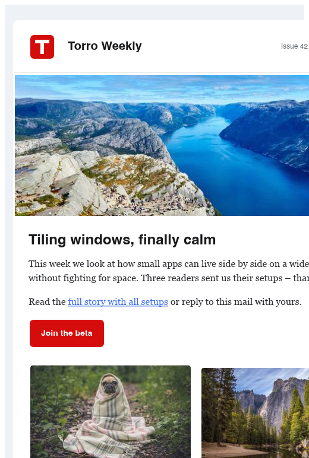 | 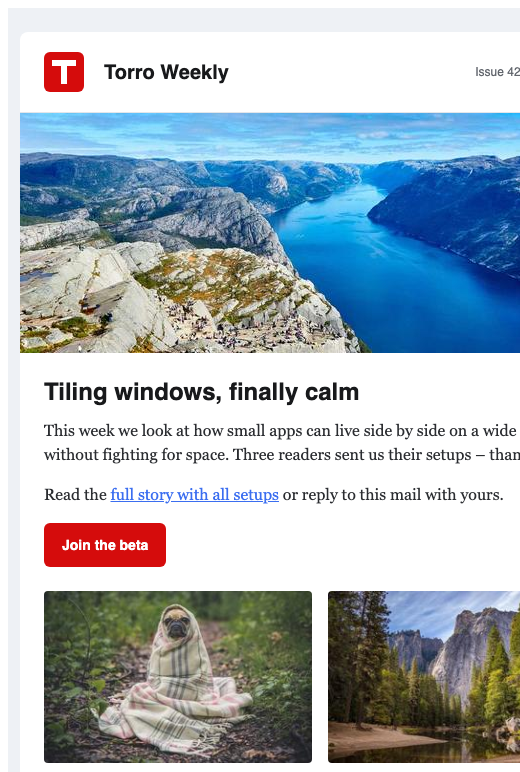 |
| Rechnung eines Shops | 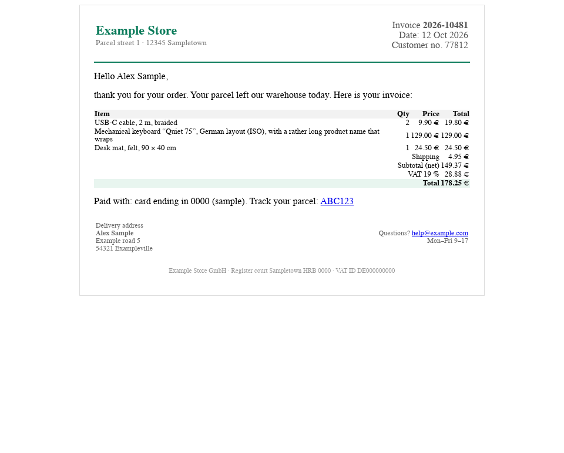 | 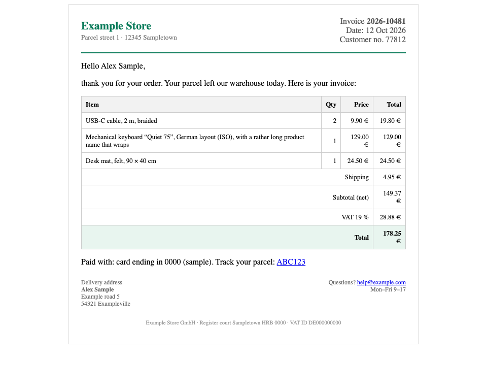 |
| Outlook (`MsoNormal`, `<o:p>`, MSO-Kommentare, `font`) | 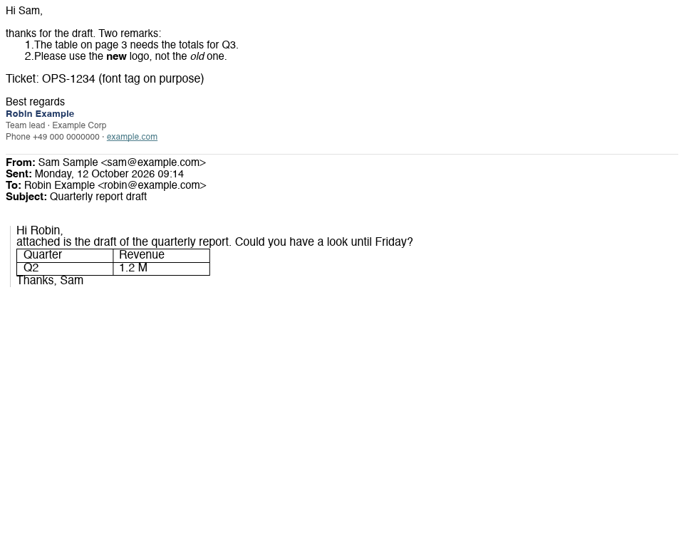 | 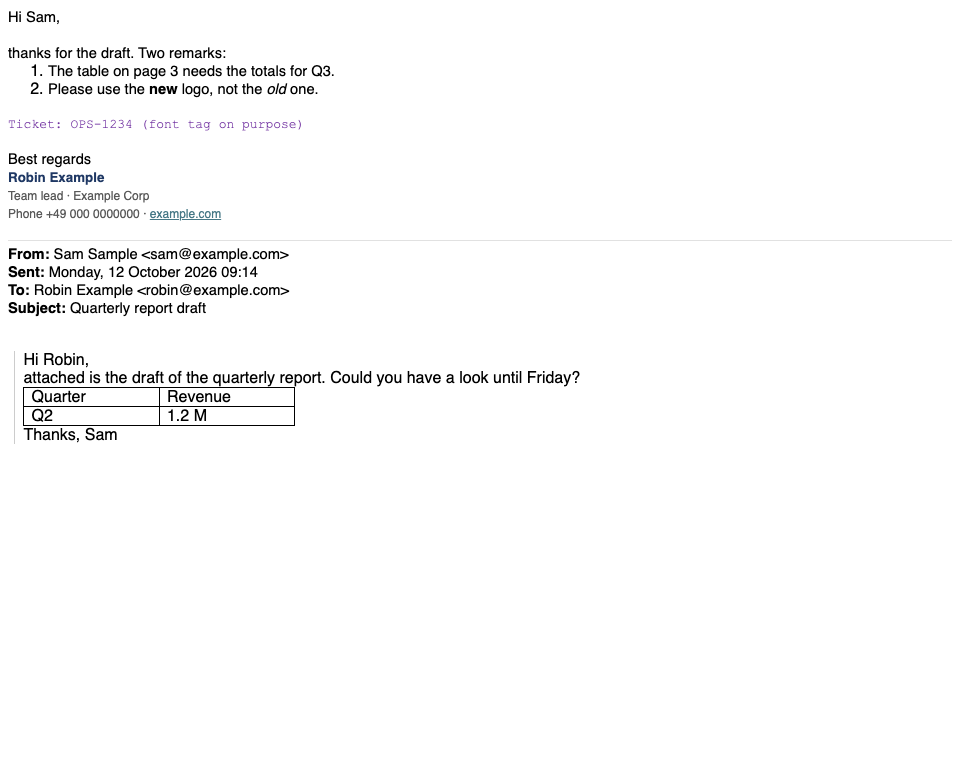 |
| `<style>`-Block, Media Query, Flexbox, Float, Webfont |  | 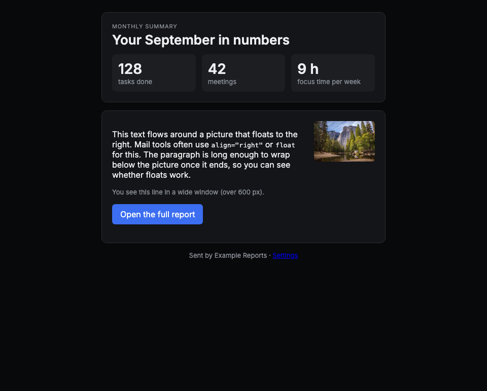 |
| dasselbe dunkel (`prefers-color-scheme`) | 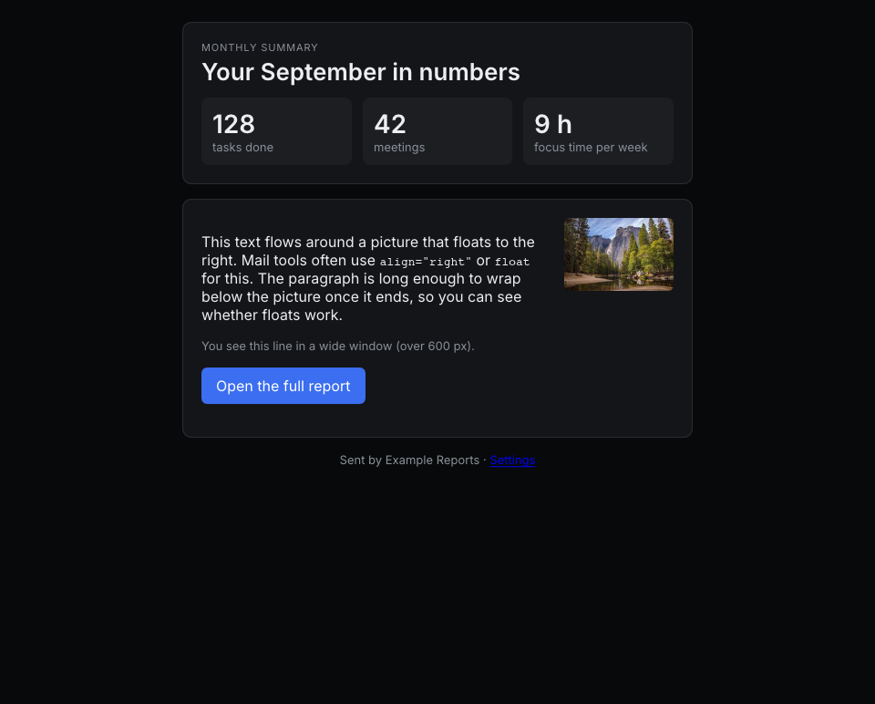 |  |
| dasselbe schmal (Media Query greift) | 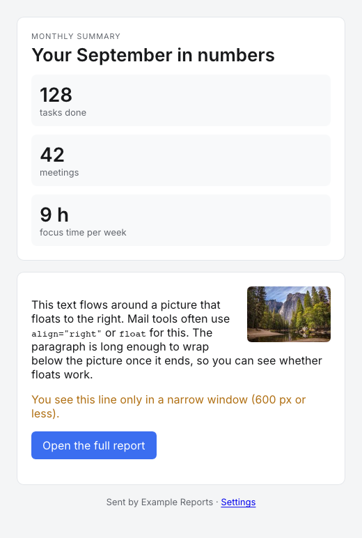 | 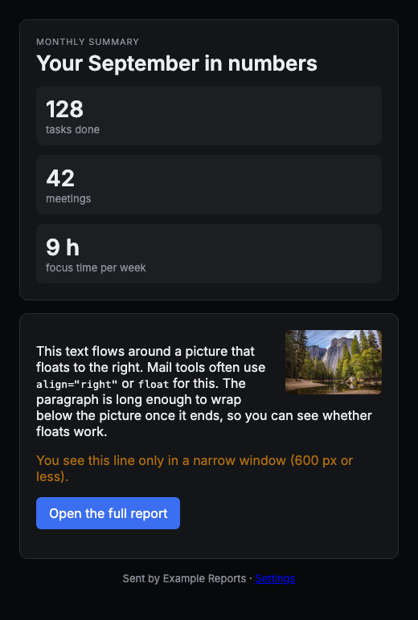 |
| Textmail als `<pre>` | 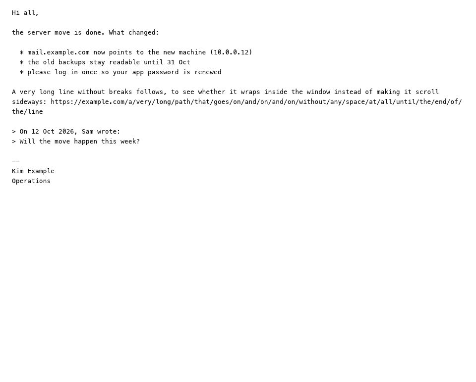 | 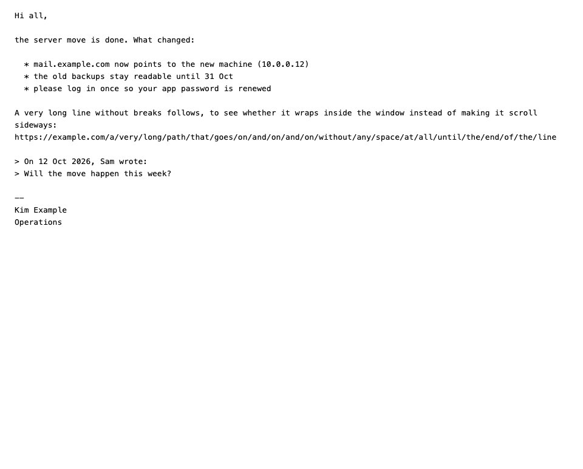 |
| Lange Mail (über 1 MiB) | 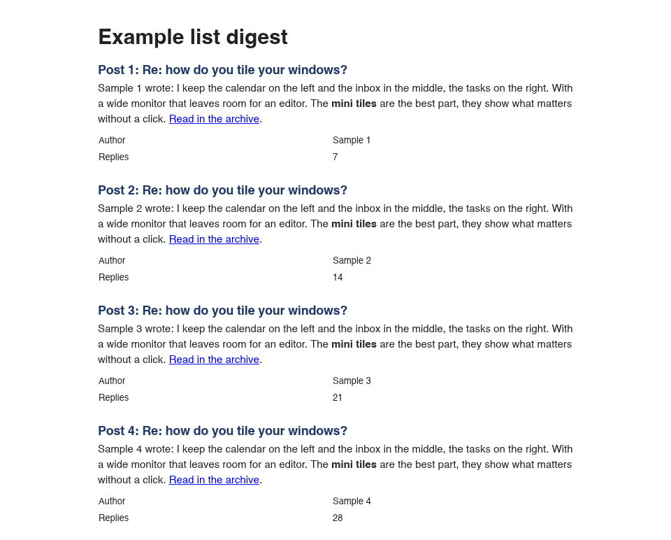 | 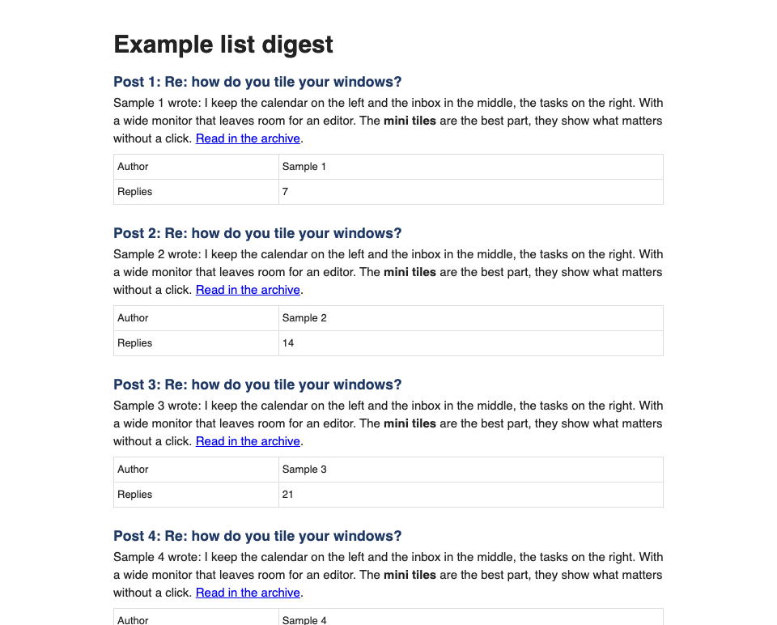 |

Bedienung: [Link geklickt](../spikes/blitz-iced/shots/probe-link-blitz.png),
[Text markiert](../spikes/blitz-iced/shots/probe-select-blitz.png),
[gescrollt](../spikes/blitz-iced/shots/probe-scroll-blitz.png). Dunkel ohne eigene Farben der Mail:
[Newsletter](../spikes/blitz-iced/shots/newsletter-dark-blitz.png), [Textmail](../spikes/blitz-iced/shots/plain-dark-blitz.png).
Chrome zeigt dieselben Mails dunkel genauso (weißes Papier), deshalb dort ohne eigenes Bild.

### Was fehlt oder falsch aussieht

1. **Alte Darstellungs-Attribute fehlen** (Blitz kennt `align`, `width`/`height`, `bgcolor`, `hspace`/`vspace`, `border`
   an `img`): `cellpadding` (Zellen der Rechnung kleben), `cellspacing` (Blitz lässt 2 px `border-spacing`, im
   Newsletter sieht man Spalten), `border` an `<table>` (Rechnung und lange Mail ohne Linien), ``
   (Outlook-Zeile in falscher Schrift, Größe, Farbe). Genau dieses HTML ist in Mails häufig. Abhilfe: im Kern bei der
   Bereinigung in Inline-CSS übersetzen (klein) oder in Blitz beitragen.
2. **Tabellenbreiten** weichen ab: `width="30%"` an einer Zelle ergibt in Blitz etwa die Hälfte; zwei 50-%-Zellen
   werden unterschiedlich breit und um 4 px versetzt.
3. Kleinigkeiten: Listennummer ohne Abstand („1.The“), `h3` etwas größer als im Browser.
4. **Bilder hinter Weiterleitungen** (Fehler oben) – ohne Umgehung fehlen fast alle Newsletter-Bilder.
5. **`blitz-net` bringt `native-tls`** mit (unter Linux OpenSSL) – gegen die Regel „nur rustls“. Im Produkt ein
   eigener `NetProvider` über das `reqwest` des Workspace (rustls); den braucht es für `cid:` ohnehin.
6. **Barrierefreiheit:** Iced 0.14 hat keinen Baum für Screenreader; die Mail ist für sie nur ein Bild. Die Webview in
   `torromailview` liest vor.
7. Nicht im Versuch: Suchen in der Mail, Kontextmenü, Tastatur-Scrollen, Doppelklick-Wortauswahl, Farbmanagement.
8. **Beta:** 0.3.0-beta.3 ist zwei Tage alt, die API hat sich zwischen den Alphas oft geändert; Versionen sind genau
   festgenagelt (`=0.3.0-beta.3`).

### Lizenzen der neuen Abhängigkeiten

Blitz bringt 93 Crates mit, die das Fenster ohne Blitz nicht hat. Die meisten MIT oder Apache-2.0. Abweichend:

- **MPL-2.0** (12): `stylo`, `stylo_atoms`, `stylo_derive`, `stylo_dom`, `stylo_static_prefs`, `stylo_traits`,
  `selectors`, `cssparser-macros`, `app_units`, `to_shmem`, `to_shmem_derive`, `uluru`; `stylo_taffy` MIT/Apache/MPL.
  MPL-2.0 gilt je Datei: Mit MIT/Apache-Code mischbar, solange die MPL-Dateien MPL bleiben und ihr Quelltext
  erreichbar ist (bei unveränderten Crates von crates.io gegeben); eigene Änderungen an diesen Dateien müssten
  veröffentlicht werden. Im Release in die Liste der Fremdlizenzen aufnehmen.
- **Unicode-3.0** (6): `icu_casemap`, `icu_segmenter`, `icu_locale_fallback` samt Daten-Crates.
- **BSD-3-Clause**: `alloc-no-stdlib`, `tiny-skia-path`; `brotli-decompressor` BSD-3-Clause/MIT.
- `byteorder` Unlicense/MIT, `objc2-core-text` Zlib/Apache/MIT.

Keine GPL, nichts Kostenpflichtiges.

### Systeme

- **macOS:** läuft (alle Zahlen oben).
- **Linux (Hyprland):** **nicht geprüft**, in dieser Sitzung gab es keinen Linux-Rechner. Erwartet: gleich, denn die
  Mail ist nur ein Bild in Iced – keine Webview, keine Grenze unter Wayland, kein WebKitGTK; Schriften über
  fontconfig. `blitz-net` bräuchte OpenSSL (Punkt 5). Vor einer Entscheidung auf Hyprland laufen lassen.
- **Windows:** `cargo xwin check --release --target x86_64-pc-windows-msvc` ohne Fehler; nicht gestartet.

### Empfehlung: erst später

Die Technik trägt: Die Mail steht als Widget im Iced-Fenster, gezeichnet in wenigen Millisekunden, ohne zweites
Fenster, ohne zweiten Prozess, ohne Webview-Pakete und ohne JavaScript, das abzuschalten wäre. Für einen Wechsel
von `torromailview` ist es aber zu früh:

- Blitz ist Beta, und gerade das alte Mail-HTML (Tabellen-Attribute, ``) sieht noch falsch aus; dazu der
  Weiterleitungs-Fehler bei Bildern.
- +19–23 MB je Programm, das Mail zeigt; Mail ist für Screenreader nur ein Bild.
- `torromailview` zeigt dieselben Mails heute richtig.

Wieder ansehen, wenn (a) Blitz 0.3 stabil ist und die Darstellungs-Attribute kennt – oder wir sie bei der
Bereinigung in CSS übersetzen –, (b) der Versuch auf Hyprland läuft und (c) möglichst Iced auf wgpu ≥ 30 steht, damit
Weg 1 ohne Bildkopie möglich wird. Dann wäre Blitz als Lesebereich in TorroInbox der Ersatz für `torromailview`; die
Befehle aus M9.1 bleiben gleich. Entschieden wird mit dem Menschen, nicht hier.
