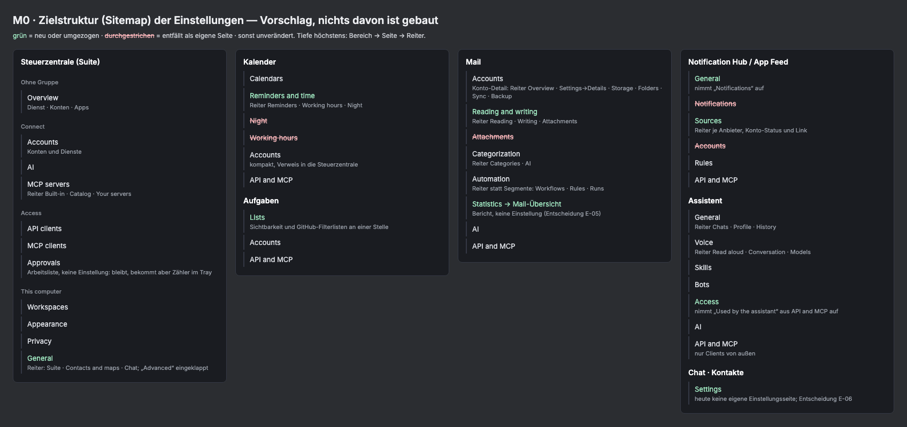
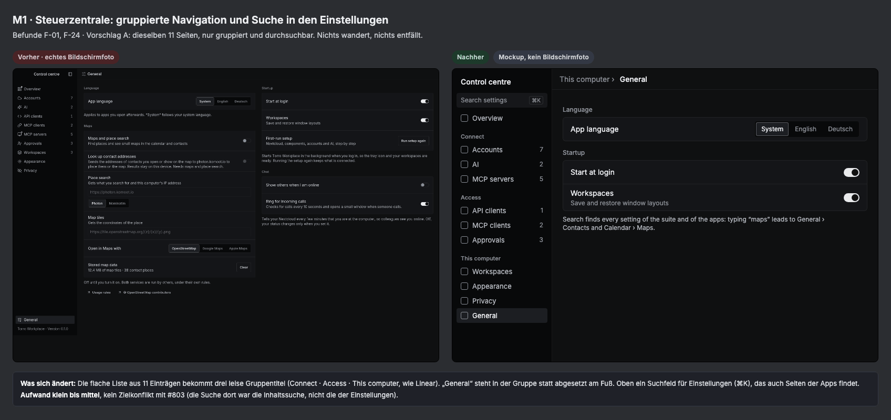
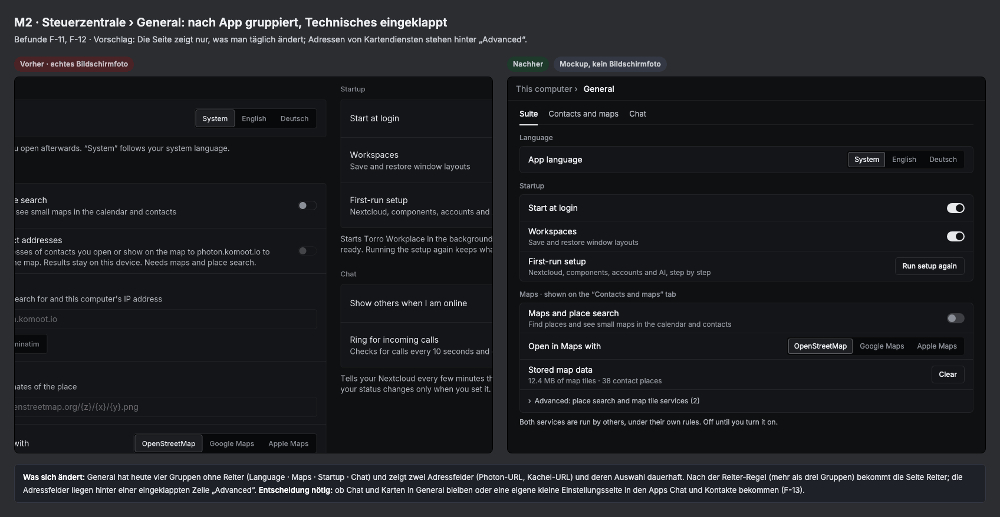
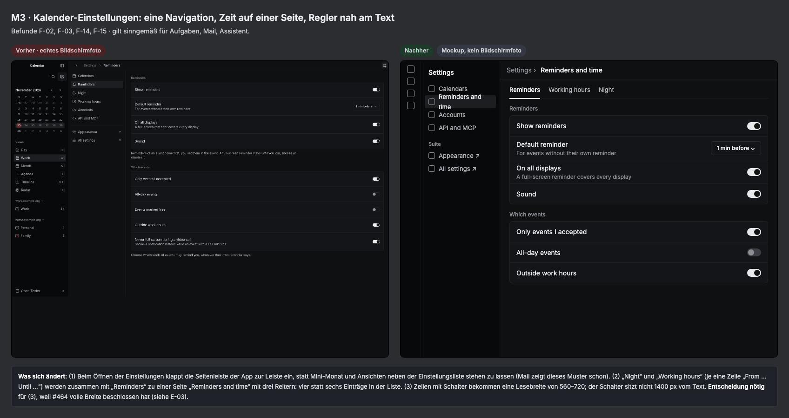
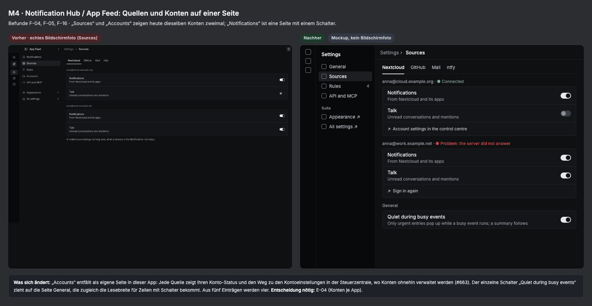
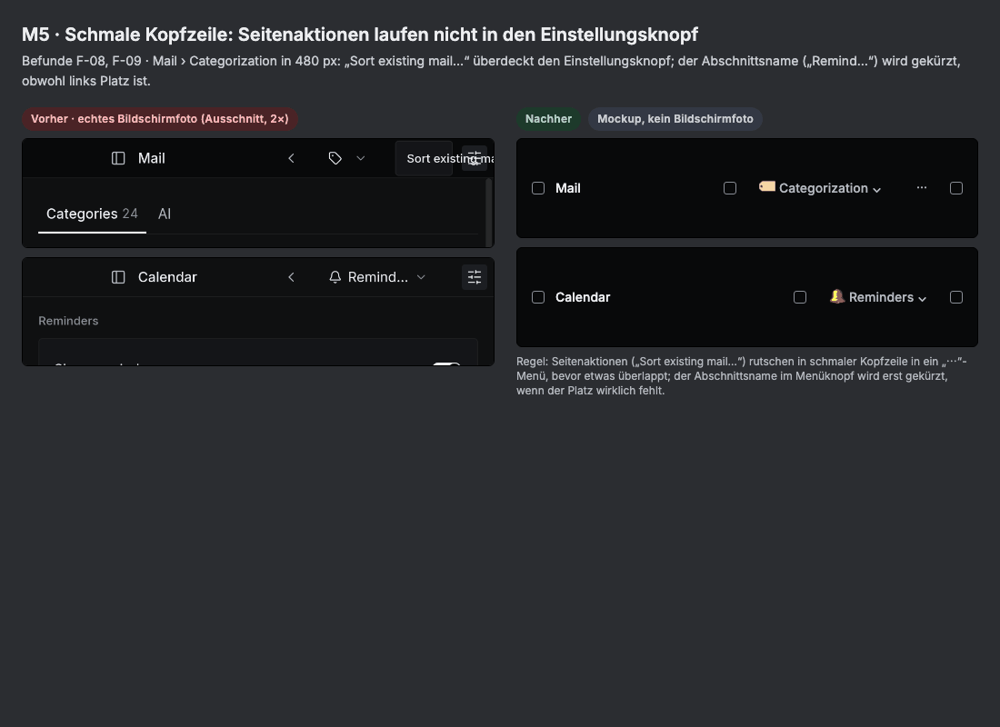

# UX-Audit der Einstellungen (Issue #968)

Visuelles Audit **aller Einstellungsseiten** der Steuerzentrale und der Apps, mit Bildern aus der laufenden Demo, Befunden, Regelvorschlag, Mockups und priorisierten
Empfehlungen. Stand: 2026-11-23, `main` bei `7789963d`. **Es wurde kein Produktcode geändert**; alles hier ist Dokumentation und Bildmaterial.

## Lesereihenfolge

| Datei | Inhalt |
|---|---|
| [recommendations.md](recommendations.md) | **Zuerst lesen.** Entscheidungen E-01 bis E-09, priorisierte Maßnahmen, Folge-Issues, Reihenfolge |
| [findings.md](findings.md) | 28 Querschnittsbefunde mit Bild, Befunde je Seite, was gut ist, Abgleich mit bestehenden Issues, offene Prüfungen |
| [design-rules.md](design-rules.md) | Zielstruktur (Sitemap) und Regeln R1–R14 als Vorschlag |
| [inventory.md](inventory.md) | Vollständiges Inventar mit Links zu jedem Bild, **Lücken** (was nicht erreichbar war) |
| [mockups/](mockups/) | Vorher-nachher-Mockups M1–M5 und die Sitemap M0 (HTML-Quelle + PNG) |
| [screenshots/](screenshots/) | alle Bilder, nach Bereich: `cc` (Steuerzentrale), `calendar`, `tasks`, `hub`, `mail`, `assistant` |
| [sheets/](sheets/) | Übersichtsbögen (6 bis 9 Seiten auf einem Bild): `pages-<bereich>-<dunkel/hell>-<breit/schmal>-<n>.png` für die Hauptseiten, `states-<bereich>-<n>.png` für die Zustände |
| [evidence/](evidence/) | Ausschnitte der Fehlerstellen (F-08, F-09, F-10) |
| [capture.sh](capture.sh), [compress.py](compress.py) | so entstehen die Bilder (reproduzierbar) |

## Methode

- **Bilder**: `torroworkplace ui` und die Apps mit `--demo --settings <abschnitt>` bzw. `--section`/`--open <zustand>` und `--shots`: Die App zeichnet ihre Oberfläche im Speicher
  (kein Fenster, kein Netz, keine echten Daten; Anleitung im Skill `torro-design`, Abschnitt 9). Jede Datei heißt `<seite>_<hell|dunkel>_<breit|mittel|schmal>.png`, doppelt aufgelöst.
- **Umfang**: 40 Hauptseiten (dazu die Hub-Ansicht „Notification Hub“; dunkel breit/schmal, hell breit, ausgewählt mittel) und 146 Zustände und Unterseiten (dunkel breit/schmal). Gesamt 480 Bilder und 44 Übersichtsbögen.
- **Bewertung**: Kriterien aus Issue #968 (Informationsarchitektur, Progressive Disclosure, kognitive Last, Konsistenz, Gruppierung, Defaults, Suche, Rückmeldung, Barrierefreiheit, Responsivität)
  gegen den Skill `torro-design` und `docs/settings.md`.
- **Mockups**: sind als solche gekennzeichnet („Mockup, kein Bildschirmfoto“); „Vorher“ ist immer ein echtes Bildschirmfoto.
- **Ressourcen**: Ein Build (`CARGO_BUILD_JOBS=4`, `nice`), danach nur das Starten der fertigen Programme. Es lief kein zweiter Rust-Build des Audits.
  Die Build-Ordner anderer Arbeiten wurden nicht angetastet (der Zielordner dieses Worktrees ist eine Kopie auf APFS).

## Ergebnis in Kürze

- Das System trägt: Bausteine, Detailseiten, hell/dunkel, schmale Ansicht, „API and MCP“ in allen Apps gleich.
- Die Probleme liegen im **Gerüst**: zwei Navigationsspalten in Apps, Mini-Seiten, doppelte Konten, volle Breite ohne Lesebreite, fehlende Suche, ungruppierte Zentrale.
- **Drei echte Fehler** (P1): überlappende Kopfzeile in schmalem Mail-Fenster, abgeschnittener Text bei Freigaben, gekürzter Abschnittsname im Kalender.
- **Neun Entscheidungen** sind offen; die P1-Maßnahmen brauchen keine.
- **Nicht gesehen**: Reiter außer dem ersten (kein Aufrufparameter), Tastatur/Hover, deutsche Texte, echtes Fenster, Chat und Kontakte (haben keine Einstellungen) – siehe [Inventar › Lücken](inventory.md#lücken-nicht-erreichbar-oder-nicht-aufgenommen).

## Mockups

| | |
|---|---|
|  | **M0** Zielstruktur (Sitemap) |
|  | **M1** Steuerzentrale: Gruppen und Suche |
|  | **M2** General: Reiter und „Advanced“ |
|  | **M3** Kalender: eine Navigation, Zeit auf einer Seite |
|  | **M4** Hub: Quellen und Konten |
|  | **M5** Schmale Kopfzeile |
