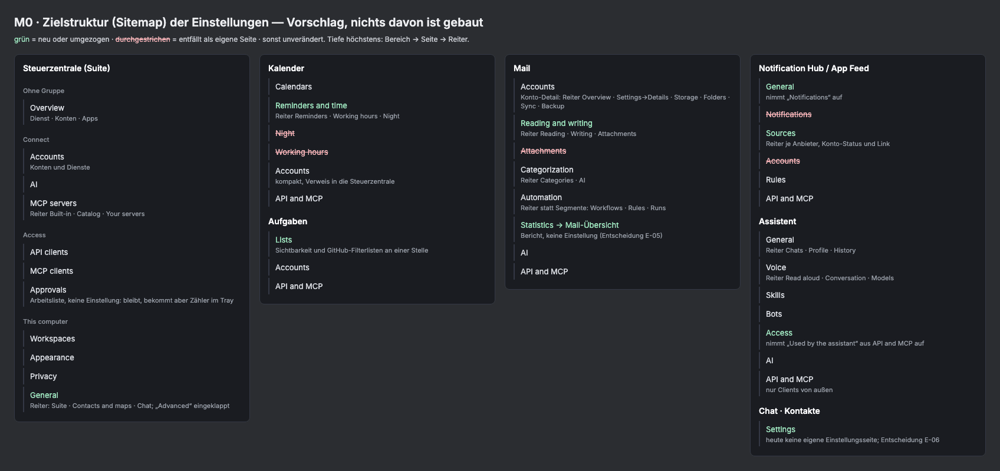

# Zielstruktur und Regeln für Einstellungen (Vorschlag)

**Status: Vorschlag zur Entscheidung, nichts davon ist gebaut oder im Skill `torro-design` eingetragen.** Die Regeln ergänzen `docs/settings.md` und den Skill; wo sie
eine bestehende Regel ändern, steht das dabei. Gewünscht ist kein tieferes Verschachteln, sondern flacheres, auffindbareres Aufbauen.

## Zielstruktur (Sitemap)

Auf einen Blick (grün in der Grafik = neu oder umgezogen):

- **Steuerzentrale**: Overview · Connect (Accounts, AI, MCP servers) · Access (API clients, MCP clients, Approvals) · This computer (Workspaces, Appearance, Privacy, General).
- **Kalender**: Calendars · **Reminders and time** (Reiter: Reminders, Working hours, Night) · Accounts · API and MCP.
- **Aufgaben**: **Lists** (inkl. GitHub-Filterlisten) · Accounts · API and MCP.
- **Mail**: Accounts · **Reading and writing** (Reiter: Reading, Writing, Attachments) · Categorization · Automation · AI · API and MCP; Statistics wandert in die Mail-Übersicht.
- **Notification Hub / App Feed**: **General** (nimmt Notifications auf) · **Sources** (Reiter je Anbieter, Konten nur als Status) · Rules · API and MCP.
- **Assistent**: General · Voice · Skills · Bots · **Access** (nimmt „Used by the assistant“ auf) · AI · API and MCP.
- **Chat, Kontakte**: je eine Seite „Settings“ **oder** Reiter in General (Entscheidung E-06).

Tiefe: **Bereich → Seite → Reiter**. Detailseiten (ein Konto, ein Client) sind die dritte Ebene und haben ihre eigenen Reiter. Eine vierte Ebene gibt es nicht.
Ergebnis in Zahlen: Kalender 6 → 4 Seiten, Hub 5 → 4, Mail 8 → 6, Assistent 7 → 7 (Inhalt umgebaut); die Steuerzentrale bleibt bei 11 Seiten in 3 Gruppen.

## Regeln

Die Nummern sind stabil und werden in den Befunden und Folge-Issues zitiert. **Neu** = gibt es im Skill noch nicht; **ändert** = ändert eine bestehende Regel; **bestätigt** = steht schon im Skill, wird hier nur mit Beleg wiederholt.

### R1 · Navigation: Bereich → Seite → Reiter (bestätigt, mit Schranke)
Eine Seite wird erst bei **mehr als drei Gruppen** (oder auf einer Seite, die im normalen Fenster deutlich übersteht) in Reiter geteilt (bestätigt, #529/#763).
**Neu:** Und sie ist erst eine eigene Seite, wenn sie **mindestens etwa drei Zeilen oder zwei Gruppen** hat. Weniger wird eine Gruppe auf einer verwandten Seite (F-03).

### R2 · Ein Gerüst im Einstellungsmodus (neu)
Öffnet man die Einstellungen einer App, klappt ihre Seitenleiste zur Leiste ein und stellt sich beim Schließen wieder her; es steht höchstens **eine** Liste mit Namen neben dem Inhalt (F-02).
Ausnahme: Hat die App-Seitenleiste in den Einstellungen eine Funktion (selten), bleibt sie.

### R3 · Gruppen in der Seitenleiste ab acht Einträgen (neu)
Hat eine Seitenleiste von Einstellungen **mehr als acht** Einträge, bekommt sie leise Gruppentitel (`typo::caption()`, `TEXT_3`): Connect · Access · This computer. Gruppentitel sind keine Ebene und keine Zeilen (F-01).

### R4 · Zeilenbreite: Bedienelement nah am Text (ändert #464, nur mit E-03)
Zeilen mit **Schalter, Segment oder Dropdown** haben eine Lesebreite von höchstens `size::content_max()` (720); die Seite bleibt bündig links.
Tabellen, Listen mit Chevron, Editoren und Diagramme laufen weiter über die ganze Breite. Auf breiten Fenstern ist der freie Platz Platz für `page_columns` (zwei Spalten, #464) statt Leerraum zwischen Text und Schalter (F-14, F-15).

### R5 · Tabs und Segmente (bestätigt)
Reiter = Teile einer Seite oder eines Objekts. Segmente = Ansichten derselben Daten oder eine Wahl aus bis zu vier Werten. Automation: Reiter (F-06).

### R6 · Speichern (bestätigt, präzisiert)
Standard: automatisch. Ausnahmen mit Prüfung oder Editor: **eine** Form, die Speicherleiste (`save_bar`) unten, solange etwas geändert ist. Kein eigener Speichern-Knopf in der Seite (F-07). Rot ist Primärknopf, ein Fenster hat höchstens einen.

### R7 · Zeilenaktionen (bestätigt, mit Schranke)
Eine sichtbare Aktion je Zeile, der Rest im „…“-Menü. **Neu:** Löschen und Entfernen stehen **nie** offen in der Zeile, sondern im „…“-Menü mit Rückfrage oder Undo (F-16).

### R8 · Progressive Disclosure (neu)
Auf der ersten Ebene stehen Dinge, die man **wöchentlich** ändert. Adressen, Ports, Kachel-URLs, Werkzeugnamen und Pfade stehen hinter einer eingeklappten Zeile „Advanced“ (Chevron 12, `TEXT_2`), einmal je Gruppe, höchstens eine offene pro Seite. „Show commands“ im Assistenten ist dieselbe Regel und bleibt (F-11, F-28).

### R9 · Begriffe
Ein Wort je Ding, überall:

| Ding | Wort | Nicht |
|---|---|---|
| Einstellungen der Suite | **Control centre** (Fenster), **Suite settings** (Fußlink in Apps) | „All settings“ |
| Seite der Suite „General“ | **General** | „All apps“ als zweite Bezeichnung |
| Rechte-Seite in Apps | **API and MCP** | – (Steuerzentrale: API clients, MCP clients) |
| Reiter eines Mail-Kontos mit Name, Server | **Details** | „Settings“ |
| Notification Hub / App Feed | Titel der Einstellungen nennt beide | zwei Namen für dieselbe Seite |
| Konten | **Accounts** | „Sources“ für Konten |

### R10 · Schmal: nichts überlappt, nichts wird stumm gekürzt (bestätigt, präzisiert)
Seitenaktionen in der Kopfzeile wandern in ein „⋯“-Menü, **bevor** sie den Einstellungsknopf berühren. Der Abschnittsname im Menüknopf bekommt den freien Platz; gekürzt wird nur, wenn der Platz fehlt, mit „…“ und Tooltip. Text, der entscheidet (Freigaben), bricht um (F-08, F-09, F-10).

### R11 · Konten: Verwalten in der Zentrale, Nutzen in der App (nur mit E-04)
Wer in einer App ein Konto braucht, wählt oder verbindet es dort; die **Liste aller Konten mit Dienst und Verwaltung** steht in der Steuerzentrale. Apps zeigen davon den Status und einen Link; „Add account…“ gibt es in der App nur, wo ohne Konto nichts geht (Ersteinrichtung).

### R12 · Leerzustände (bestätigt)
Ein Satz, was hier erscheint, und ein Knopf; linksbündig in der Gruppe, nie zentriert in leerer Fläche (F-27).

### R13 · Suche (neu, nur mit E-02)
Eine Einstellungssuche (⌘K / Strg K) in Steuerzentrale und Apps: findet Seiten, Gruppen und Zeilen aller installierten Apps (Titel und Beschreibung), springt zur Zeile und markiert sie kurz. Ergebnisse nennen den Pfad („Calendar › Reminders and time › Night“).

### R14 · Tastatur und Fokus (bestätigt, unbelegt)
Tab-Reihenfolge, Pfeile in Reitern und Segmenten, Escape zurück: im Skill gefordert, aus Bildern nicht prüfbar. Siehe offene Prüfungen in [findings.md](findings.md#6-offene-prüfungen).

## Was aus den Regeln folgt (Beispiele)

| Beispiel | Regel | Mockup |
|---|---|---|
| Kalender: eine Navigation, „Reminders and time“ | R1, R2, R4 | [M3](mockups/m3-calendar-one-navigation.png) |
| Steuerzentrale: Gruppen und Suche | R3, R13 | [M1](mockups/m1-control-centre-navigation.png) |
| General: Advanced, Reiter | R1, R8 | [M2](mockups/m2-general-progressive-disclosure.png) |
| Hub: Quellen mit Konto-Status | R11 | [M4](mockups/m4-hub-sources-accounts.png) |
| Schmale Kopfzeile | R10 | [M5](mockups/m5-narrow-header-actions.png) |
