# Befunde

Grundlage: die Bilder in [`screenshots/`](screenshots/) (Demo-Daten, ohne Fenster), die Designregeln im Skill `torro-design` und `docs/settings.md`.
Bewertet wird nach den Kriterien aus Issue #968: Informationsarchitektur, Progressive Disclosure, kognitive Last, Konsistenz (Begriffe, Abstände,
Typografie), Gruppierung, Defaults, Suche, Rückmeldung/Fehler, Barrierefreiheit/Tastatur, Responsivität.

**Schwere:** hoch = sichtbarer Fehler oder Regelverstoß mit Folgen für Bedienung · mittel = Reibung oder Inkonsistenz, die man bemerkt · niedrig = Feinschliff.
**Priorität:** P1 = zuerst (billig, klar) · P2 = nächster Schritt · P3 = später oder erst nach Entscheidung. **Aufwand:** S (Stunden) · M (Tage) · L (Wochen).
Entscheidungen für den Nutzer stehen als **E-xx** in [recommendations.md](recommendations.md).

Was **nicht** geprüft werden konnte (Tastatur, Hover, Fokus, echte Fenster, deutsche Texte, nicht wählbare Reiter), steht in [inventory.md](inventory.md#lücken-nicht-erreichbar-oder-nicht-aufgenommen)
und unter „Offene Prüfungen“ am Ende.

## Inhalt

1. [Gesamtbild](#1-gesamtbild)
2. [Querschnittsbefunde F-01 bis F-28](#2-querschnittsbefunde)
3. [Befunde je Seite](#3-befunde-je-seite)
4. [Was gut ist und bleiben soll](#4-was-gut-ist-und-bleiben-soll)
5. [Abgleich mit bestehenden Issues](#5-abgleich-mit-bestehenden-issues)
6. [Offene Prüfungen](#6-offene-prüfungen)

## 1. Gesamtbild

Die Einstellungen folgen einem erkennbaren System: Seitenleiste mit Abschnitten, rechts Gruppen aus Zeilen, Schalter und Segmente für wenige Optionen,
Detailseiten mit festem Aufbau, hell und dunkel gleichwertig, schmal als Menü statt Seitenleiste. Die Seite „API and MCP“ ist in allen fünf Apps
identisch gebaut, was Wiederfinden erleichtert. Die Probleme liegen weniger im einzelnen Baustein als im **Gerüst um die Seiten**:

1. **Zu viele Ebenen und Spalten nebeneinander.** In Apps stehen die App-Seitenleiste, die Abschnittsliste und die Seite gleichzeitig; im Kalender
   sind Mini-Monat und Ansichten noch sichtbar, während man Erinnerungen einstellt (F-02).
2. **Zu kleine Seiten.** Mehrere Seiten bestehen aus einer Zeile oder einem Schalter und brauchen trotzdem einen Eintrag in der Liste (F-03).
3. **Dieselben Dinge an mehreren Orten.** Konten stehen in der Steuerzentrale und in jeder App; im Hub zweimal in einer App; die Rechte des Assistenten an zwei Stellen (F-04, F-18).
4. **Volle Breite ohne Lesebreite.** Auf 1600 px liegt der Schalter über 1000 px vom Text entfernt (F-14).
5. **Wenige echte Fehler**, aber sichtbare: überlappende Kopfzeile in schmalem Mail-Fenster, hart abgeschnittener Text bei Freigaben (F-08, F-10).
6. **Auffindbarkeit.** Keine Suche in den Einstellungen; 11 Abschnitte ungruppiert; für Chat und Kontakte gibt es keine Einstellungsseite (F-01, F-13, F-24).

Die Zahlen: **40 Seiten** (dazu Zustände und Unterseiten) in 6 Bereichen, **4 Bereiche mit Reitern**, 11 Abschnitte der Steuerzentrale, 8 Abschnitte in Mail (die größte App), 7 im Assistenten.

## 2. Querschnittsbefunde

Je Befund: Ist-Zustand · Begründung · Vorschlag. Bilder zeigen die Stelle.

### F-01 · Steuerzentrale: elf Abschnitte in einer flachen Liste
**Schwere** mittel · **Prio** P2 · **Aufwand** S–M · **Entscheidung** E-01

Ist: Overview, Accounts, AI, API clients, MCP clients, MCP servers, Approvals, Workspaces, Appearance, Privacy und, abgesetzt am Fuß, General. Keine Gruppierung;
„Approvals“ ist eine Arbeitsliste, „Overview“ ein Dashboard, der Rest Einstellungen.
Begründung: Elf gleichrangige Einträge verlangen Suchen durch Lesen; Verwandtes (Konten/KI/MCP-Server einrichten; API-/MCP-Clients/Freigaben zugriffsbezogen) steht nicht beieinander,
General steht nicht dort, wo man es als Letztes der „Rechner“-Seiten erwartet.
Vorschlag: drei leise Gruppentitel (Connect · Access · This computer), siehe [Mockup M1](mockups/m1-control-centre-navigation.png).

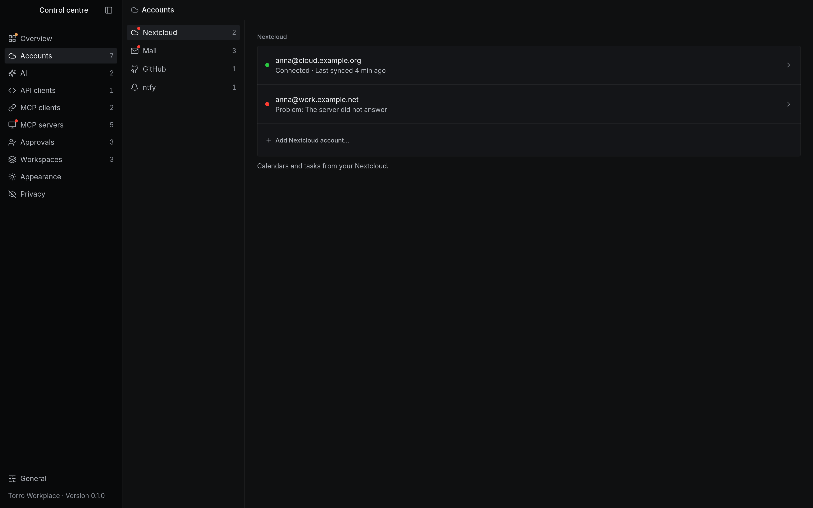

### F-02 · In Apps: zwei Navigationsspalten neben dem Inhalt
**Schwere** mittel · **Prio** P1–P2 · **Aufwand** M · **Entscheidung** keine (Muster existiert in Mail)

Ist: Öffnet man das Zahnrad, bleibt die ganze App-Seitenleiste stehen (Kalender: Mini-Monat, Ansichten, Kalenderliste; Assistent: Suche, Bots, 20 Konversationen; Mail: Icon-Leiste),
daneben die Abschnittsliste der Einstellungen. Auf 1600 px bleiben rund 55 % für die Seite; auf 800 px (mittel) wird es eng.
Begründung: Zwei Listen verlangen zwei Orientierungen („wo bin ich in der App, wo in den Einstellungen?“). Mini-Monat und Ansichten haben in den Einstellungen keine Funktion.
#210 hat „im selben Fenster, zurück genau dorthin“ entschieden, nicht „App-Navigation bleibt voll sichtbar“.
Vorschlag: Beim Öffnen der Einstellungen klappt die App-Seitenleiste zur Leiste ein (Mail zeigt es schon so), Zustand wird beim Schließen wiederhergestellt. [Mockup M3](mockups/m3-calendar-one-navigation.png).

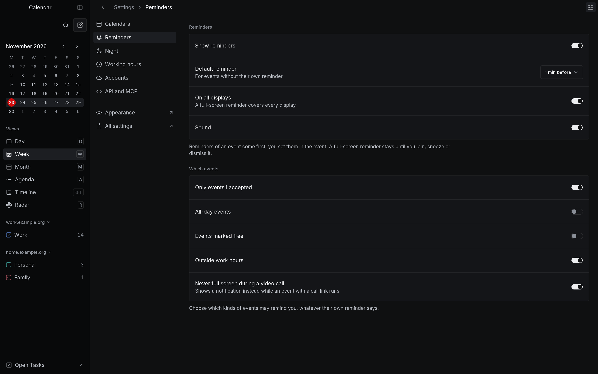 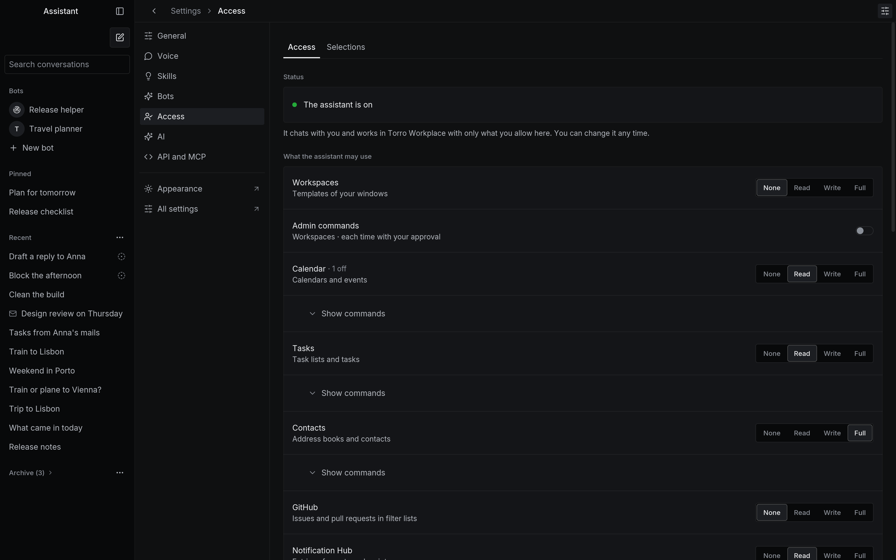

### F-03 · Seiten mit einer Zeile oder einem Schalter
**Schwere** mittel · **Prio** P2 · **Aufwand** S–M

Ist: Kalender › **Night** (eine Zeile „From … Until …“) und **Working hours** (dito); Hub › **Notifications** (ein Schalter „Quiet during busy events“);
Assistent › **Skills** enthält neben zwei Skills einen Hinweis „Tools moved to the control centre“.
Begründung: Jede dieser Seiten kostet einen Eintrag in der Liste und einen Klick, bringt aber kaum Inhalt. Die Reiter-Regel (mehr als drei Gruppen → Reiter) hat hier ein Gegenstück: **weniger als drei Zeilen → keine eigene Seite**.
Vorschlag: Kalender „Reminders and time“ mit Reitern Reminders · Working hours · Night; Hub „General“ nimmt Notifications auf. [M3](mockups/m3-calendar-one-navigation.png), [M4](mockups/m4-hub-sources-accounts.png).

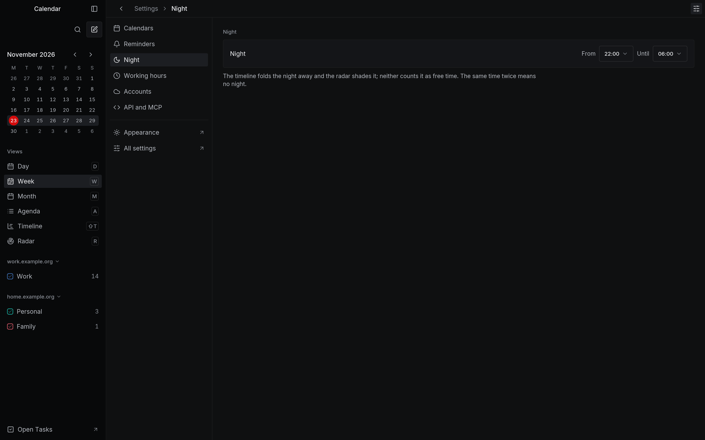 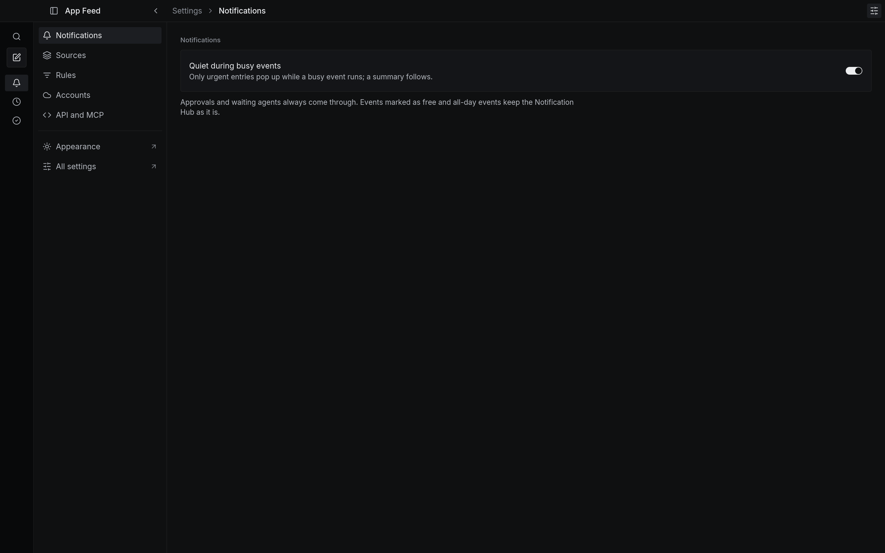

### F-04 · Dieselben Konten an vielen Orten; im Hub doppelt in einer App
**Schwere** mittel · **Prio** P2 · **Aufwand** M · **Entscheidung** E-04

Ist: Die Kontenliste mit „Add … account…“ gibt es in der Steuerzentrale, im Kalender, in Aufgaben, im Hub und in Mail (jeweils eine andere Teilmenge der Anbieter); im Hub außerdem als
„Sources“ (Schalter je Konto) **und** „Accounts“ (Liste derselben Konten). Die Seite „AI“ in Mail und Assistent wiederholt die KI-Konten der Steuerzentrale.
Begründung: #410 hat das so entschieden („jede App verbindet ihre Konten selbst“) – der Preis ist Wiederholung. Der Hub setzt sie auf die Spitze.
Vorschlag: im Hub „Accounts“ streichen und in „Sources“ pro Quelle Status plus Link in die Steuerzentrale zeigen ([M4](mockups/m4-hub-sources-accounts.png)); alle anderen Apps vorerst unverändert, bis E-04 entschieden ist.

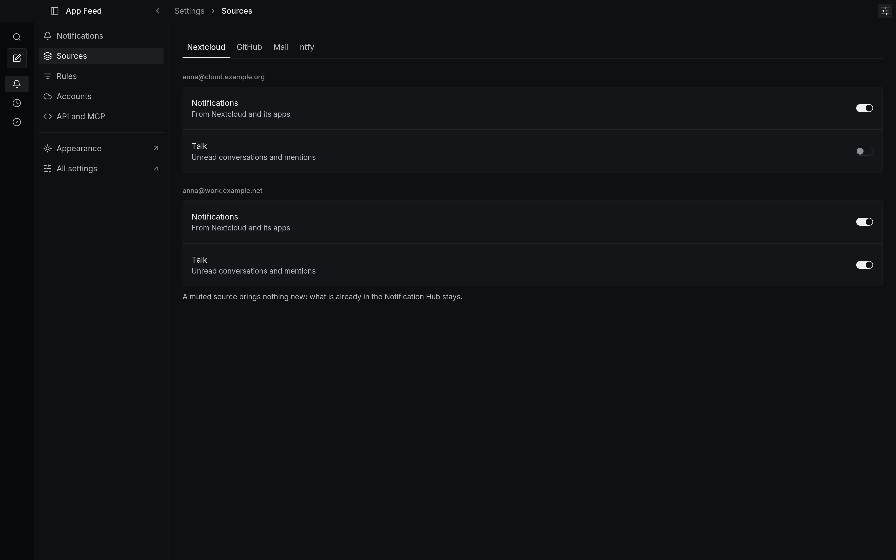 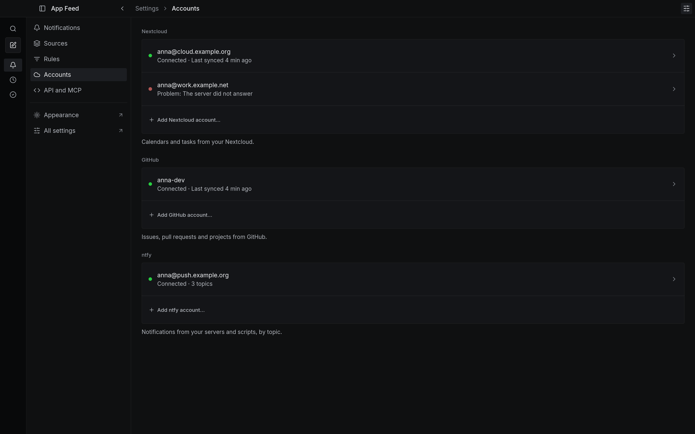

### F-05 · Ein Programm, zwei Namen: „App Feed“ und „Notification Hub“
**Schwere** niedrig · **Prio** P3 · **Aufwand** S

Ist: `torroinbox --view notifications` heißt in der Kopfzeile „App Feed“, `--view hub` „Notification Hub“; die Einstellungen beider sind identisch. Im Tray stehen „App Feed“ und (als Gruppe) „Notification Hub“.
Begründung: Wer die Einstellungen sucht, weiß nicht, ob sie für eines oder beide gelten.
Vorschlag: Im Titel der Einstellungen den Geltungsbereich nennen („Settings · App Feed and Notification Hub“) oder die Namen angleichen (Teil der Begriffsliste, F-17).

### F-06 · Reiter und Segmente für dasselbe
**Schwere** niedrig · **Prio** P2 · **Aufwand** S

Ist: Mail › Automation wechselt „Workflows · Rules · Runs“ über kleine Segmente (`segmented`); alle anderen Seiten (Categorization, Statistics, Sources, Voice, Access, General) nehmen unterstrichene Reiter.
Begründung: Der Skill sagt: `segmented` wechselt die Ansicht derselben Daten, Reiter den Teil einer Seite. „Workflows/Rules/Runs“ sind Teile.
Vorschlag: `tabs` verwenden.

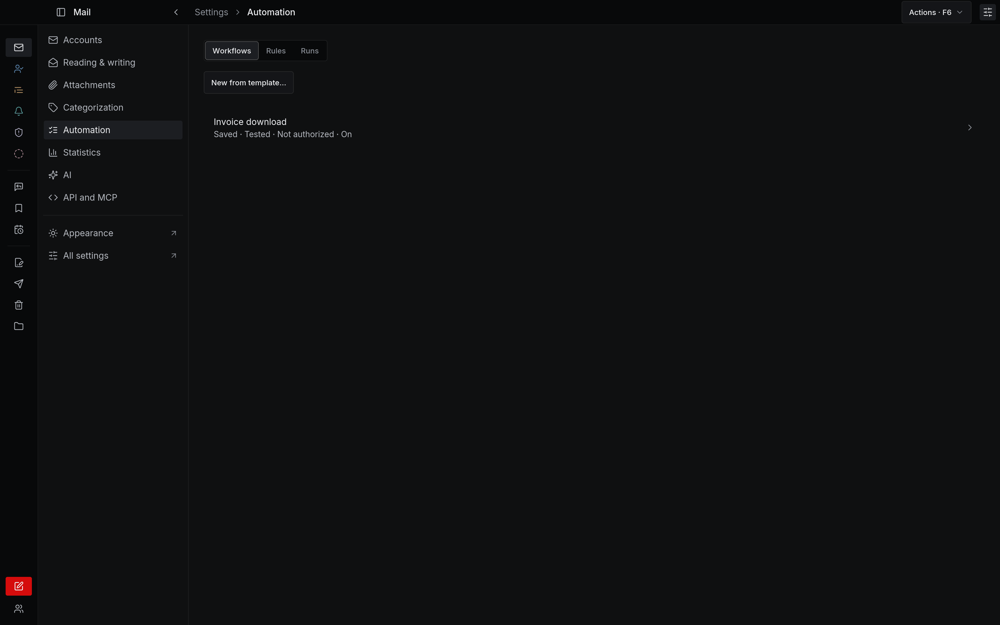 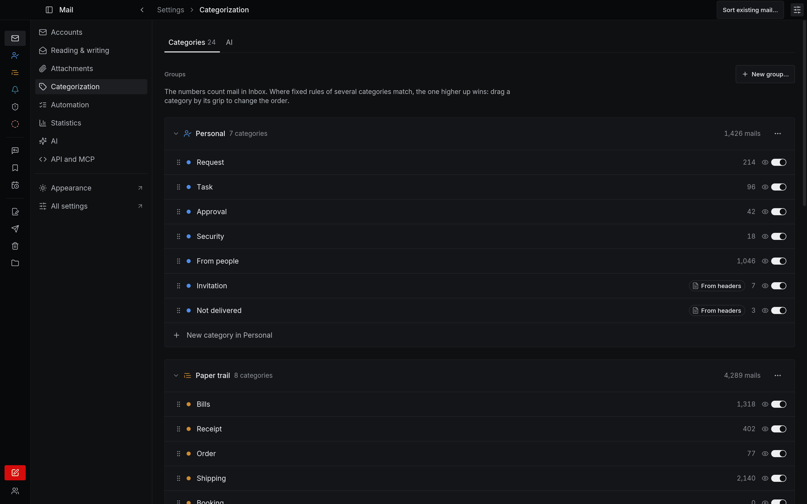

### F-07 · Drei Speichermodelle
**Schwere** niedrig · **Prio** P3 · **Aufwand** S

Ist: Fast alles speichert sofort. Mail › Reading & writing hat für die Signatur eine eigene Leiste „Discard · Save signature“ (Save in Rot, solange nichts geändert ist ausgegraut);
das Mail-Konto zeigt unten eine schwebende Leiste „Display name changed · Discard · Save“; Dialoge haben „Save“.
Begründung: Die Regel kennt die Speicherleiste (`save_bar`) – die Signatur nutzt eine eigene Form, und ein rotes „Save signature“ ist ein zweiter Primärknopf neben Seiten ohne Primärknopf.
Vorschlag: Signatur über `save_bar`; Rot nur für den Primärknopf des Fensters.

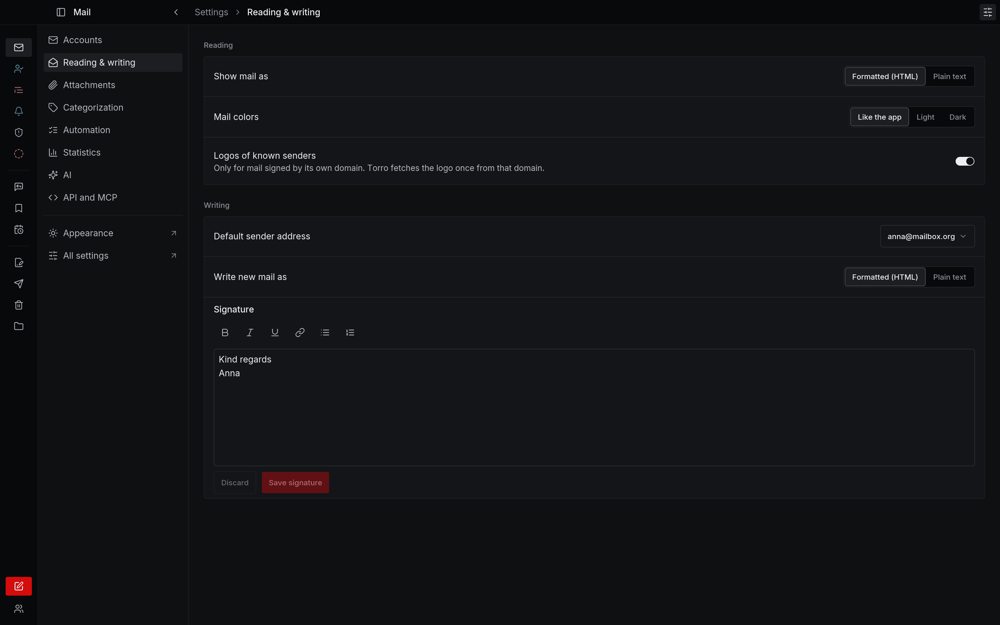

### F-08 · Schmale Mail-Einstellungen: Seitenaktion überlappt den Einstellungsknopf
**Schwere** hoch · **Prio** P1 · **Aufwand** S

Ist: Mail › Categorization bei 480 px: „Sort existing mail…“ wird abgeschnitten und liegt **über** dem Einstellungsknopf.
Begründung: Verstoß gegen „nie überlappen“ (Skill, Abschnitt 6) und gegen die feste Position des Einstellungsknopfs (Abschnitt 0). Das Bild ist ein reproduzierbarer Befund, kein Demo-Artefakt.
Vorschlag: Seitenaktionen wandern in schmaler Kopfzeile in ein „⋯“-Menü ([M5](mockups/m5-narrow-header-actions.png)).

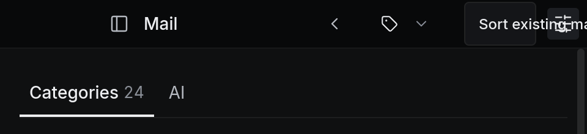

### F-09 · Schmal: Abschnittsname im Menüknopf gekürzt, obwohl Platz ist
**Schwere** niedrig · **Prio** P2 · **Aufwand** S

Ist: Der Menüknopf des Abschnitts hat eine feste Höchstbreite: Im Kalender steht im Kopf „‹ [Calend… ▾]“ und „‹ [Remind… ▾]“, obwohl links neben „‹“ etwa die halbe Breite frei ist (der Titel „Calendar“ hat festen Platz). Kürzere Namen (Lists, Sources, Voice, Access) passen und zeigen den Fehler nicht.
Begründung: Kürzen ist erlaubt, wenn der Platz fehlt – hier fehlt er nicht. Der Name ist das Einzige, was in der schmalen Ansicht sagt, wo man ist.
Vorschlag: Der Menüknopf bekommt den freien Platz; Titel „Calendar“ darf zuerst weichen oder nur als Icon stehen.

### F-10 · Freigaben: Text wird hart abgeschnitten
**Schwere** mittel · **Prio** P1 · **Aufwand** S

Ist: Control centre › Approvals bei 480 px: „Delete event "Dentist" … from "Fa" und „The client may not write to this cal“ enden mitten im Wort, ohne „…“ und ohne Tooltip;
bei „Weekly review“ endet die Zeile mit „16:00 f“.
Begründung: Verstoß gegen „nie stumm abschneiden“ (Skill, Abschnitt 5, „Werte, die nicht passen“). Bei Freigaben entscheidet der Text, was man erlaubt – Kürzen ohne Hinweis ist hier kritischer als anderswo.
Vorschlag: `typo::ellipsize` mit Tooltip, bei Platz mehrzeilig umbrechen.

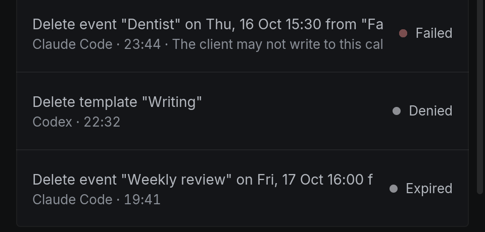

### F-11 · General: technische Adressen auf der ersten Ebene
**Schwere** niedrig–mittel · **Prio** P2 · **Aufwand** S · gehört zu #548 (offen)

Ist: „Place search“ und „Map tiles“ zeigen je ein Adressfeld (`https://photon.komoot.io`, `https://tile.openstreetmap.org/{z}/{x}/{y}.png`), grau und wie deaktiviert wirkend; darüber die tägliche Wahl „Open in Maps with“.
Begründung: Progressive Disclosure: Adressen von Kartendiensten ändert fast niemand. Die grauen Platzhalter lesen sich wie gesperrte Felder.
Vorschlag: hinter „Advanced“ einklappen ([M2](mockups/m2-general-progressive-disclosure.png)).

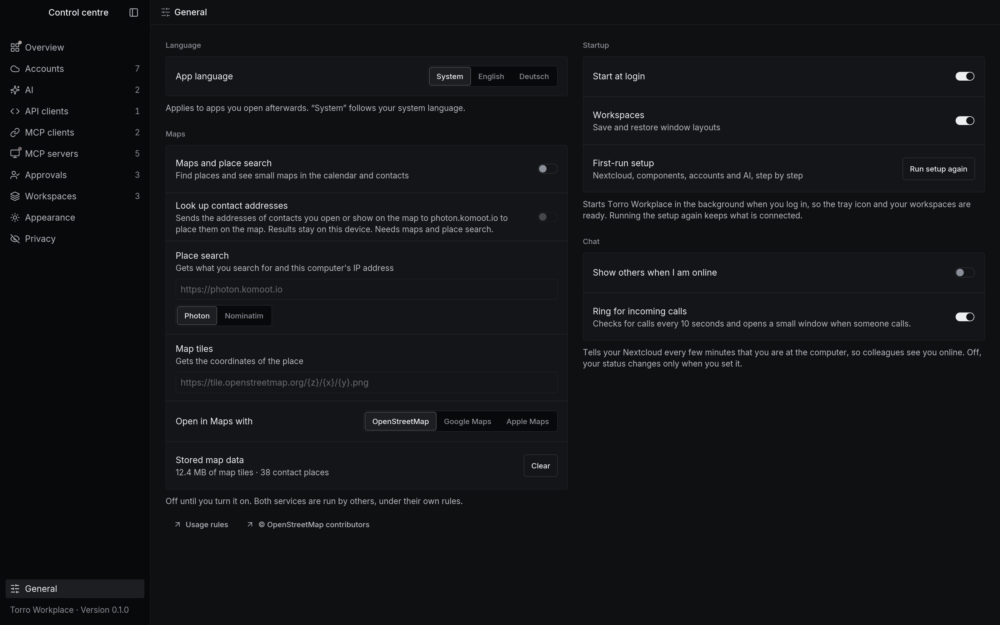

### F-12 · General: vier Gruppen ohne Reiter
**Schwere** niedrig · **Prio** P2 · **Aufwand** S · bereits als offener Punkt in #548

Ist: Language · Maps · Startup · Chat, zweispaltig; die Reiter-Regel (mehr als drei Gruppen) greift hier nicht.
Vorschlag: siehe M2; Entscheidung E-06 (wohin Chat und Karten gehören).

### F-13 · Chat und Kontakte haben keine Einstellungsseite
**Schwere** mittel · **Prio** P2–P3 · **Aufwand** M · **Entscheidung** E-06

Ist: Beide Apps haben kein Zahnrad und nutzen `torro-settings-ui` nicht (im Code geprüft). Karten (Kontakte, Kalender) und „Show others when I am online“/„Ring for incoming calls“ (Chat) stehen in der Steuerzentrale › General.
Begründung: Die Regel in `docs/settings.md` („Was nur diese App betrifft, steht in der App“) gilt hier nicht; die Einstellung zu einer App liegt in einer anderen Anwendung. „Jede App einzeln installierbar“ (#528) macht das zum Loch: Wer nur Chat hat, findet keine Einstellung.
Vorschlag: entweder je eine kleine Seite in der App (Zahnrad) oder bewusst in General lassen, dann aber nach App beschriftet und mit Reitern.

### F-14 · Volle Breite: Schalter weit vom Text
**Schwere** mittel · **Prio** P2 · **Aufwand** S–M · **Entscheidung** E-03

Ist: Zeilen und Trennlinien laufen über die ganze Breite (laut #464 gewollt); Schalter, Segmente und Dropdowns sitzen am Zeilenende. Auf 1600 px liegt der Schalter in Kalender › Reminders, Aufgaben › Lists, Assistent › Access bis über 1000 px vom Text.
Begründung: Das Auge muss die Zeile entlang wandern; Fehlklicks auf die Nachbarzeile steigen. Zeilen ohne Hover-Markierung verschärfen das. Linear und macOS-Einstellungen begrenzen die Zeilenbreite.
Vorschlag: Lesebreite 560–720 für Zeilen mit Bedienelement, Tabellen und Editoren bleiben voll. Bricht mit #464 – daher Entscheidung E-03.

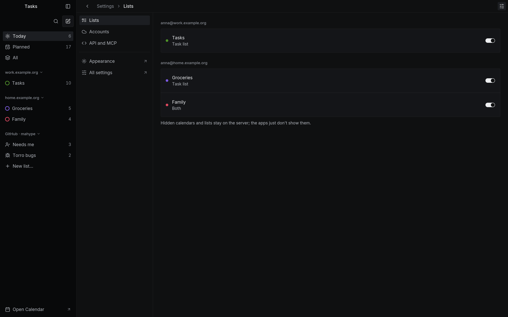

### F-15 · Kurze Seiten füllen links ein Drittel und lassen den Rest leer
**Schwere** niedrig · **Prio** P3 · **Aufwand** S

Ist: Detailseiten (Konto, Erweiterung, API-Client) und viele Einzelseiten haben links Inhalt, rechts rund 50 % Leerraum; `page_columns` wird dort nicht genutzt.
Vorschlag: bei Detailseiten die Eigenschaften als zweite Spalte (Eigenschaften-Spalte wie im Rest der Suite); sonst akzeptieren – Leerraum ist kein Fehler.

### F-16 · Zeilenaktionen: fünf Muster
**Schwere** mittel · **Prio** P2 · **Aufwand** S–M

Ist: Hub › Rules **„Remove“** als Text-Knopf (ohne Rückfrage sichtbar); Skills ✎ und 🗑 als Icons; Bots „Edit“ und „Access“ als Text-Knöpfe; Workspaces „Load“ + „…“; Konten Chevron; Assistent › Access „Show commands“ als Zeile.
Begründung: Der Skill sagt: „Eine sichtbare Aktion je Zeile, der Rest im ‚…‘-Menü.“ Rules und Skills zeigen die destruktive Aktion offen.
Vorschlag: Eine sichtbare Aktion, Löschen im „…“-Menü mit Rückfrage bzw. Undo.

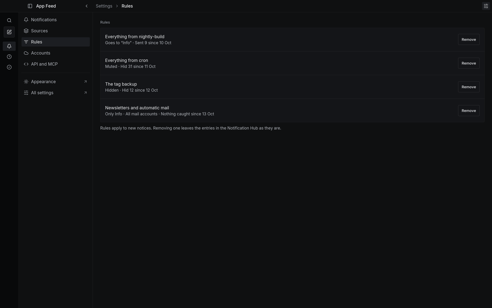 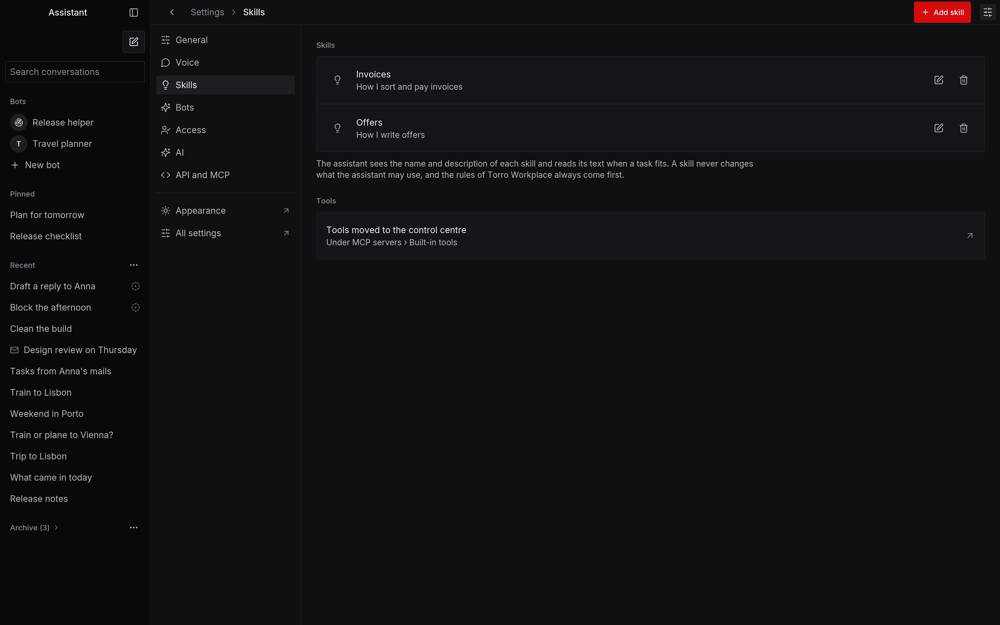

### F-17 · Begriffe
**Schwere** mittel · **Prio** P2 · **Aufwand** S

| Stelle | Heißt | Konflikt |
|---|---|---|
| Fuß der App-Abschnittsliste | „All settings ↗“ | führt nur zu Control centre › **General**, nicht zu allen Einstellungen |
| Steuerzentrale | „General“ | in der App heißt dasselbe „All settings“, im Assistenten (ohne Hauptanwendung) zusätzlich „All apps“ (`suite-general`) neben seinem eigenen „General“ |
| App | „API and MCP“ | Steuerzentrale: „API clients“ und „MCP clients“ (zwei Seiten) |
| Mail-Konto | Reiter „Settings“ | steht in „Settings › Accounts › Konto“ – Einstellungen in Einstellungen |
| Tray / Kopf | „App Feed“ / „Notification Hub“ | F-05 |
| Mail | „Reading & writing“ | in Mail-Konto „Writing“ als eigener Reiter |
Vorschlag: eine Begriffsliste (siehe [design-rules.md](design-rules.md#r9-begriffe)), z. B. „Suite settings“ für den Fußlink, Reiter „Details“ statt „Settings“.

### F-18 · Rechte des Assistenten an zwei Orten
**Schwere** mittel · **Prio** P2 · **Aufwand** M · **Entscheidung** E-07

Ist: Assistent › Access (Reiter Access · Selections): „What the assistant may use“ mit None/Read/Write/Full je Bereich. Assistent › API and MCP: „Used by the assistant“ mit Schaltern je eingebautem Werkzeug und MCP-Server plus „Show commands“.
Begründung: #666 hat die zweite Ebene bewusst getrennt („was darf der Assistent nutzen“ vs. „was dürfen Clients von außen“). Für den Nutzer ist es dieselbe Frage, an zwei Stellen, in zwei Ausdrucksformen (Segment vs. Schalter).
Vorschlag: „Used by the assistant“ in Access aufnehmen (ein Reiter „Tools“), „API and MCP“ bleibt nur für Clients von außen wie in allen anderen Apps.

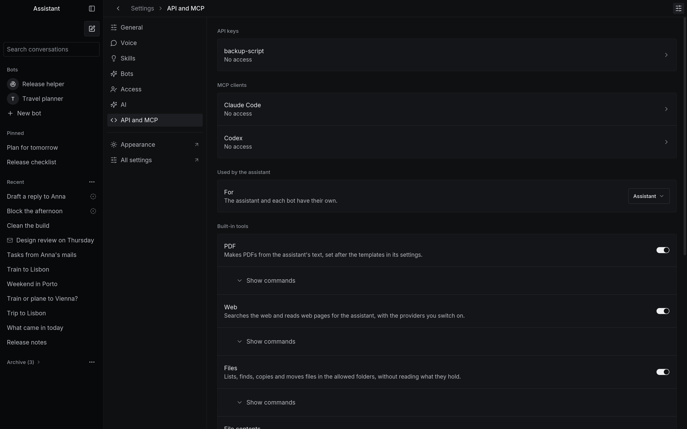 

### F-19 · Assistent: Skills trägt einen Umzugshinweis
**Schwere** niedrig · **Prio** P3 · **Aufwand** S

Ist: Skills enthält die Gruppe „Tools“ mit der Zeile „Tools moved to the control centre“ (Link). #763 hatte als Zielbild „Abilities“ mit Skills · Tools · Web search; gebaut ist Skills allein, Tools sind in die Steuerzentrale gezogen.
Vorschlag: Hinweis nach einigen Versionen entfernen; Zielbild von #763 aktualisieren.

### F-20 · Mail › Statistics ist ein Bericht, keine Einstellung
**Schwere** niedrig · **Prio** P3 · **Aufwand** M · **Entscheidung** E-05

Ist: Der Abschnitt zeigt Kennzahlen und ein Säulendiagramm („What comes in“) mit vier Reitern. Es gibt hier nichts einzustellen außer Zeitraum und Konto.
Vorschlag: In die Mail-Übersicht verlagern (dort stehen „What comes in“ und „What's new“ schon, #545); der Einstellungsabschnitt entfällt.

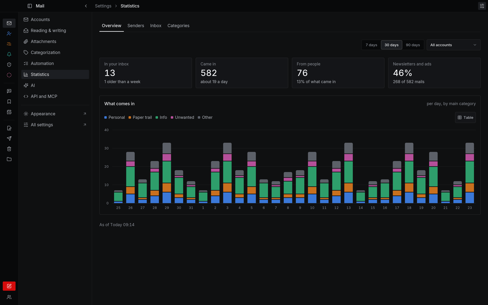

### F-21 · Mail-Konto: sechs Reiter, Reiter „Settings“, doppelte Status-Anzeige
**Schwere** niedrig · **Prio** P3 · **Aufwand** S

Ist: Overview · Settings · Storage & search · Folders · Sync · Backup; im Kopf die Pille „Syncing · 3 of 4“ **und** ein Knopf „Syncing…“; das Kopfsymbol „⋯“.
Vorschlag: Reiter „Settings“ in „Details“ umbenennen (F-17); Pille und Knopf zusammenführen.

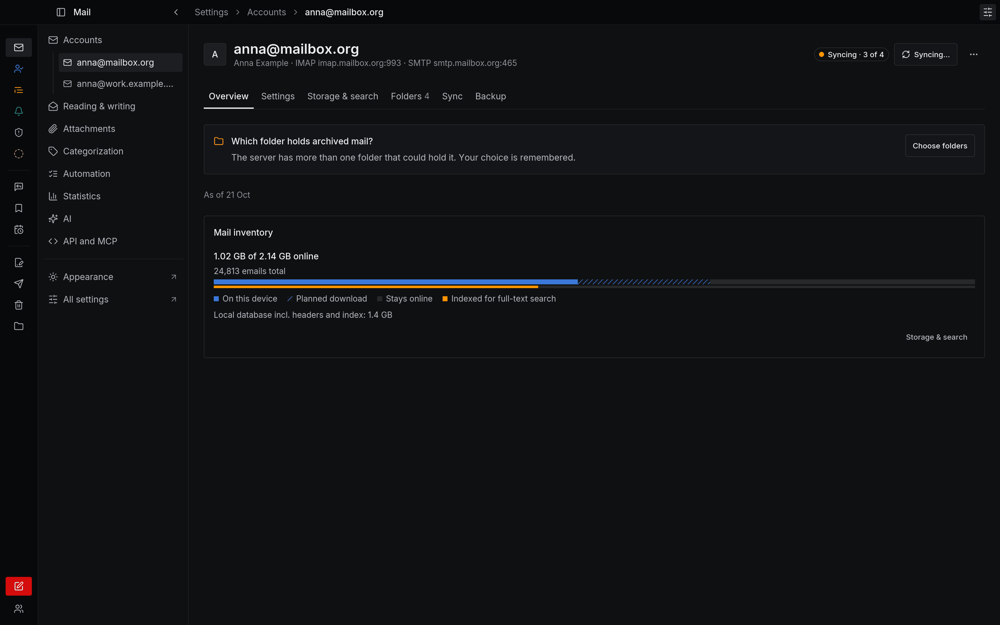

### F-22 · Categorization: 24 Zeilen mit je vier Bedienelementen
**Schwere** niedrig · **Prio** P3 · **Aufwand** M

Ist: Je Kategorie Ziehgriff, Farbpunkt, Name, Zahl, Auge, Schalter; Gruppen mit „…“. Die Seite ist sehr lang; „New group…“ und „Sort existing mail…“ stehen an verschiedenen Orten (Seite, Kopfzeile).
Vorschlag: Aktionen an einer Stelle; Auge und Schalter zu einem Bedienelement („Show in sidebar“) zusammenfassen – Rückfrage an Mail-Nutzung, daher P3.

### F-23 · Ersteinrichtung: Inhalt links oben, Knöpfe rechts unten
**Schwere** niedrig · **Prio** P3 · **Aufwand** S

Ist: Im Setup (breit) liegen Inhalt und Fußleiste weit auseinander; im Fuß bis zu vier Knöpfe („Back · Skip AI · Choose myself · Use suggestion/Keep my choice“), der rote Primärknopf wechselt seine Bedeutung.
Vorschlag: Fußleiste an die Breite des Inhalts binden; höchstens zwei Knöpfe, Alternativen als Textlinks im Inhalt.

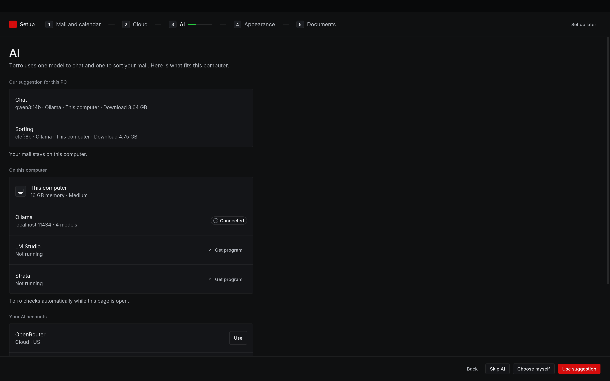

### F-24 · Keine Suche in den Einstellungen
**Schwere** mittel · **Prio** P2 · **Aufwand** M · **Entscheidung** E-02

Ist: Die Steuerzentrale hat bewusst keine Suche (#803: sie fand nur Inhalte). Die Apps suchen in Inhalten, nicht in Einstellungen. Wer „Karten“ oder „Hey Torro“ sucht, muss raten, ob es in der Zentrale oder in einer App steht – bei 40 Seiten in 6 Bereichen.
Vorschlag: eine Einstellungssuche (⌘K / Strg K), die Seiten und Zeilen aller Apps findet und dorthin springt. [M1](mockups/m1-control-centre-navigation.png).

### F-25 · Overview: Status, Aufmerksamkeit und App-Katalog auf einer langen Seite
**Schwere** niedrig · **Prio** P3 · **Aufwand** S

Ist: „At a glance“ (vier Kacheln), „Needs your attention“, danach der App-Katalog mit großen Karten und Befehlszeile (`yay -Syu`). Seit #803 gewollt.
Begründung: Der Katalog verdrängt Status und Probleme nach oben; Karten sind groß (Beschreibung dreizeilig).
Vorschlag: nur beobachten; erst ändern, wenn mehr als fünf Apps installiert sind.

### F-26 · MCP servers › Catalog: lange Texte und vier Zustandszeichen
**Schwere** mittel · **Prio** P2 · **Aufwand** M

Ist: Jede Zeile hat Name, ein bis drei Zeilen Beschreibung, Lizenz/Version/Hinweis; rechts je nach Server „Running“, „On“, ein Pfeil „↗“ oder „Stopped after errors“; „Experimental“-Plaketten stehen auf anderer Höhe als der Name.
Begründung: Fünf Zeichen für Zustand (Punkt+Wort, Wort+Chevron, nur ↗) erschweren das Überfliegen; die Texte (Installationspfade) sind für Bedienung selten nötig.
Vorschlag: eine Statuspille an fester Stelle; Beschreibung eine Zeile, Rest im Detail.

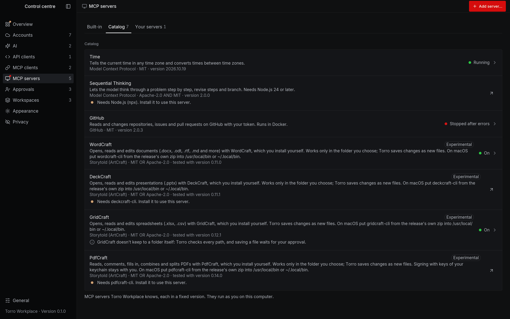

### F-27 · Leere Zustände uneinheitlich
**Schwere** niedrig · **Prio** P3 · **Aufwand** S

Ist: Approvals (leer) zeigt zentrierten Text; API clients (leer) eine Zeile „Create key…“; Accounts (leer) „No account yet.“ mit Knopf in der Gruppe.
Vorschlag: ein Leerzustand: Satz und Knopf, linksbündig in der Gruppe.

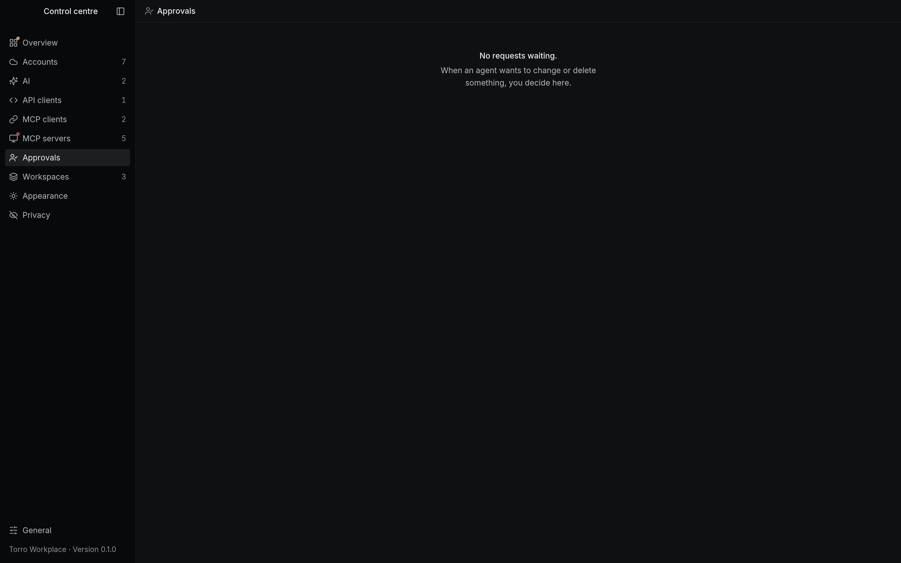 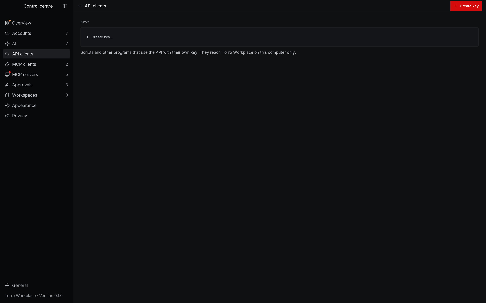

### F-28 · MCP-Client-Detail: eine lange Liste
**Schwere** niedrig · **Prio** P3 · **Aufwand** M · bereits #687

Ist: Rechte, Hooks und Werkzeuge in einer langen Spalte (Beispiel Codex: Notification Hub, Access, „Show commands“ mit technischen Namen wie `calendar_list_calendars`).
Vorschlag: Reiter wie in #687 geplant; Befund bestätigt den Bedarf.

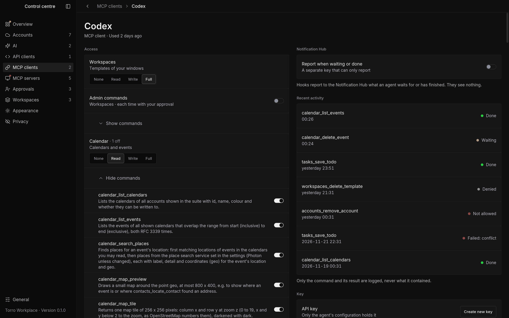

## 3. Befunde je Seite

Kürzel: **S** = Schwere (h/m/n), **P** = Priorität. Ein „–“ unter Befunde heißt: nichts Auffälliges im Bild. Bilder liegen im [Inventar](inventory.md).

### Steuerzentrale

| Seite | Ist-Zustand | Befunde | S | Vorschlag | P |
|---|---|---|---|---|---|
| Overview | Kennzahlen, Aufmerksamkeit (doppelte Demo-Zeile), App-Katalog mit „Update all (2)“ in der Kopfzeile | F-25 · Primärknopf rot oben rechts: korrekt, eine Aktion | n | nichts | – |
| Accounts | Anbieter links (Nextcloud/Mail/GitHub/ntfy), Konten rechts mit Status, „Add … account…“, Detailseite je Konto | Anbieter-Liste und Konten bilden eine zweite Seitenleiste neben der Hauptleiste (3 Spalten). Zeilen lang (Chevron 1300 px entfernt) – F-14 | n | Anbieter als Reiter oben statt zweiter Spalte, wie in schmaler Ansicht schon | P3 |
| AI | zwei Konten (OpenRouter, Ollama), „Add AI account…“ | Seite fast leer; Modellwahl steht in den Apps (#663) – ohne Hinweis hier | n | Satz „Models are chosen in Mail and Assistant“ mit Links | P3 |
| API clients | Liste der Schlüssel, „Create key“ | – (Detail: lange Rechteliste, F-28 gilt sinngemäß) | n | – | – |
| MCP clients | Befehl zum Kopieren, Liste der Clients | – | n | – | – |
| MCP servers | Reiter Built-in · Catalog · Your servers | F-26, Reiter sind korrekt eingesetzt | m | siehe F-26 | P2 |
| Approvals | wartende Freigaben mit Deny/Allow, entschiedene darunter | F-10 (abgeschnittener Text), F-27 (Leerzustand), eine Arbeitsliste in den Einstellungen (F-01) | m | siehe dort | P1 |
| Workspaces | Vorlagen und Fenstermanager in zwei Spalten, Modifier als Segmente | Segment mit vier Modifier-Kombinationen und Text „Ctrl + Option + 1 … 0“ – technisch, aber verständlich; „Save workspace…“ in der Kopfzeile ist der Primärknopf | n | – | – |
| Appearance | Abstandsvorschau, Font, Farbschema, Farbmodus, Zoom, zweispaltig | Vorbild-Seite: Vorschau macht Wirkung sichtbar. Dropdown für Schrift (Suche) korrekt | n | als Muster beibehalten | – |
| Privacy | Segmente „Always show · Ask · Never show“, Anbieterliste „Allowed/Blocked“ + ✕ | ✕ ohne Rückfrage (Forget); sonst klar | n | – | – |
| General | Language, Maps (6 Zeilen), Startup, Chat | F-11, F-12, F-13 | m | siehe M2 | P2 |

### Kalender

| Seite | Ist-Zustand | Befunde | S | Vorschlag | P |
|---|---|---|---|---|---|
| Calendars | je Konto Kalender mit Schalter und Segment „Off · Notification · Full screen“ | F-02, F-14; Schalter plus Segment je Zeile: „Off“ im Segment und Schalter aus bedeuten fast dasselbe | m | Schalter entfernen, Segment „Off · Notification · Full screen“ allein | P2 |
| Reminders | zwei Gruppen mit Schaltern | F-02, F-14; Gruppe „Which events“ hat fünf Schalter ohne Unterzeilen, bis auf einen | n | – | P3 |
| Night | eine Zeile „From … Until …“ | F-03 | m | in „Reminders and time“ | P2 |
| Working hours | eine Zeile | F-03 | m | dito | P2 |
| Accounts | Nextcloud und Mail in einer Seite | F-04, F-02 | n | vorerst | P3 |
| API and MCP | Schlüssel, Clients, Verweis „Control centre“ | Konsistent mit allen Apps (Plus). Die zwei Verweiszeilen „API clients ↗ / MCP clients ↗“ beanspruchen die Höhe zweier Zeilen für zwei Links | n | als eine Zeile „Manage clients ↗“ | P3 |

### Aufgaben

| Seite | Ist-Zustand | Befunde | S | Vorschlag | P |
|---|---|---|---|---|---|
| Lists | Nextcloud-Listen mit Schalter (GitHub-Listen fehlen); Neu-Anlegen und Bearbeiten von GitHub-Filterlisten im Dialog über das Seitenleistenmenü | Listenverwaltung auf zwei Orte verteilt (Einstellungen: Sichtbarkeit; Dialog „Edit filter list“: Inhalt) – siehe `filter-edit`, `filter-new`; F-02, F-14 | m | GitHub-Filterlisten in „Lists“ aufnehmen (Zeile → Dialog) | P2 |
| Accounts | Nextcloud, Mail, GitHub | F-04 | n | vorerst | P3 |
| API and MCP | wie Kalender | – | n | – | – |

### Notification Hub / App Feed

| Seite | Ist-Zustand | Befunde | S | Vorschlag | P |
|---|---|---|---|---|---|
| Notifications | ein Schalter | F-03, F-05 | m | in General | P2 |
| Sources | Reiter je Anbieter, Schalter je Konto und Dienst | F-04: zeigt Konten, die auch unter Accounts stehen; weitere Reiter nicht belegt (Lücke) | m | M4 | P2 |
| Rules | Liste der Regeln mit „Remove“ | F-16 | m | Remove im „…“-Menü | P2 |
| Accounts | Nextcloud, GitHub, ntfy | F-04 | m | entfällt (M4) | P2 |
| API and MCP | Muster | – | n | – | – |

### Mail

| Seite | Ist-Zustand | Befunde | S | Vorschlag | P |
|---|---|---|---|---|---|
| Accounts | je Konto Speicherbalken, Status, Schalter, Chevron; Detail mit sechs Reitern | F-21; Legende „On this device · Planned download · Stays online · Indexed“ unter der Liste ohne Bezug erklärt | n | Legende am Balken | P3 |
| Reading & writing | Gruppen Reading und Writing mit Signatur-Editor | F-07; die Seite hat zwei Gruppen und ist doch lang → Reiter Reading · Writing sinnvoll | n | Reiter, `save_bar` | P3 |
| Attachments | Klick-Verhalten, Downloads, Save targets | Save targets als Liste mit „Edit“ je Zeile; gut | n | – | – |
| Categorization | Reiter Categories · AI, 24 Kategorien in Gruppen | F-08 (schmal), F-22 | h | siehe dort | P1 |
| Automation | Segmente Workflows · Rules · Runs, Liste | F-06 | m | Reiter | P2 |
| Statistics | vier Reiter, Kennzahlen, Diagramm | F-20; Diagrammfarben und Legende folgen dem Skill (Plus) | n | verlagern | P3 |
| AI | Konten, „This computer“-Hardware, Slot „Sorting“, Verweis Control centre | F-04; Hardware-Zeile „Graphics card class“ ohne Erklärung | n | – | P3 |
| API and MCP | Muster | – | n | – | – |

### Assistent

| Seite | Ist-Zustand | Befunde | S | Vorschlag | P |
|---|---|---|---|---|---|
| General | Reiter Chats · Profile · History; Status, Account, Model, Effort | F-02; Zeile „Manage models…“ als Link | n | – | P3 |
| Voice | Reiter Read aloud · Conversation · Models; Stepper für Speed und Pause mit „Reset“ | Fortschrittszeile „Downloading … 61 %“ im Seiteninhalt; Stepper (− 100 % +) und Reset sind drei Bedienelemente je Wert | n | Regler statt Stepper prüfen | P3 |
| Skills | zwei Skills, Hinweiszeile Tools | F-19, F-16 (roter „Add skill“ in der Kopfzeile ist der Primärknopf: korrekt) | n | – | P3 |
| Bots | Liste mit Edit/Access | F-16 | n | – | P3 |
| Access | Reiter Access · Selections; Rechte je Bereich als Segment; „Show commands“ je Zeile | F-18; Segmente mit vier Optionen: zulässig (bis etwa vier) | m | E-07 | P2 |
| AI | wie Mail | F-04 | n | – | P3 |
| API and MCP | lange Seite | F-18 | m | siehe dort | P2 |

## 4. Was gut ist und bleiben soll

- **„API and MCP“ ist in allen fünf Apps gleich gebaut** (Schlüssel, Clients, Verweis in die Steuerzentrale). Das ist das beste Beispiel für „gleiche Sache, gleicher Ort, gleiche Gestalt“.
- **Appearance** zeigt die Wirkung der Abstandsstufen in einer Vorschau, bevor man wählt.
- **Segmente für wenige Optionen** (Language, Privacy, Rechte None/Read/Write/Full) und Dropdown mit Suche für Schriften: so wie in #529 entschieden.
- **Schmal**: Abschnittsmenü statt Seitenleiste, „‹“ zurück, Pfad auf Unterseiten – funktioniert in allen Apps gleich (außer den Befunden F-08/F-09).
- **Detailseiten** (Konto, Client, Erweiterung) haben festen Aufbau, Gefahr als „Remove…“ am Ende, Bestätigungsdialog mit Folge-Satz (`api-revoke`).
- **Status mit Wort und Farbe** („Connected · Last synced 4 min ago“, „Problem: …“), nie nur Punkt.
- **Hell und dunkel** gleichwertig: in den sechs verglichenen Hellbildern kein Kontrast- oder Flächenproblem erkennbar.

## 5. Abgleich mit bestehenden Issues

Kein Befund wird als neues Issue angelegt, bevor der Nutzer entschieden hat (siehe [recommendations.md](recommendations.md)). Bereits abgedeckt:

| Issue | Stand | Bezug |
|---|---|---|
| #210 Bestandsaufnahme und neue Struktur | geschlossen | Rahmen: Einstellungen im selben Fenster. F-02 präzisiert das Muster, ohne es zu ändern |
| #528 / #529 Suite-Regeln, Skill-Regeln | geschlossen | Regeln Breite, Auswahl, Reiter. F-14 stellt die Breitenregel in Frage (E-03), F-06 verlangt Regeltreue |
| #548 Steuerzentrale aufräumen | geschlossen, mit offenen Punkten | F-11, F-12 stehen dort als offene Zeilen (General › Reiter, Maps schmal) |
| #543 Kalender, #544 Aufgaben, #545 Mail, #546 Hub, #547 Assistent aufräumen | geschlossen | Seitenbefunde sind Folgen nach dem Aufräumen, keine Rückschritte |
| #663 Zentrale richtet ein, Apps regeln Zugriff | geschlossen | F-04, F-18 liegen in dessen Rahmen; keine Regeländerung nötig, nur Entscheidung E-04/E-07 |
| #763 Assistent: Einstellungen mit Tabs | geschlossen | F-19: Zielbild und Ist weichen ab |
| #803 Steuerzentrale: Apps in Übersicht | geschlossen | F-24 widerspricht nicht: #803 betraf Inhaltssuche |
| #586, #321 Prüfungen von Hand | offen | decken Sicht von Hand ab; dieser Audit liefert Bilder dafür |
| #687 Reiter auf MCP-Client-Seite | offen | F-28 bestätigt den Bedarf |
| #577 Mail: Regeln „Immer für diesen Absender“ | offen | berührt Categorization (F-22) |
| #946 Hub: GitHub nur ausgewählte Repos | offen | berührt Sources (M4) – abstimmen |

## 6. Offene Prüfungen

Nicht aus Bildern entscheidbar; für die Prüfung von Hand (nach der Regel in CLAUDE.md ohne Blockade der Umsetzung):

- [ ] Tastatur: Tab-Reihenfolge, Fokusring, Pfeile in Reitern und Segmenten, Escape beim Zurück aus Unterseiten (alle Bereiche).
- [ ] Zeilen ohne Hover-Zustand? (Bilder zeigen keinen Hover.)
- [ ] Deutsche Texte in schmaler Ansicht (`TORRO_LANG=de`): Reiter, Segmente und Menüknopf (F-09).
- [ ] Alle nicht gewählten Reiter (siehe Lücken im Inventar).
- [ ] Einstellungen im echten Fenster in 800×600: Ziehen der Spalten, F-02.
- [ ] Mail › Konto › Backup (Zustände öffnen den falschen Reiter).
- [ ] Apps ohne Hauptanwendung: eingebettete Seiten Appearance, Privacy, General.
